# GB/T 27930—2015 协议整理：报文定义与充电流程

> **标准名称**：电动汽车非车载传导式充电机与电池管理系统之间的通信协议
> **整理内容**：报文定义（第 9、10 章，标准页 5～20）+ 附录 A 充电流程（资料性附录，标准页 21～37）
> **来源文件**：`GBT-27930-2015.pdf`
> **整理方式**：报文定义基于 PDF 文本层提取；流程图基于逐页识别整理，各图附原图裁剪件，可对照查阅

**内容结构**

- [第一部分 报文定义](#第一部分-报文定义)（第 9 章报文分类总表 + 第 10 章报文格式与字段定义）
- [第二部分 附录 A 充电流程](#a1-充电工作状态转换)（原资料性附录 A，图 A.1～图 A.12）

---

## 第一部分 报文定义（第 9 章报文分类 + 第 10 章报文格式）

> 2015 版报文体系共 23 种报文，按五个阶段/类别组织：充电握手阶段（CHM/BHM/CRM/BRM）、参数配置阶段（BCP/CTS/CML/BRO/CRO）、充电阶段（BCL/BCS/CCS/BSM/BMV/BMT/BSP/BST/CST）、充电结束阶段（BSD/CSD）与错误报文（BEM/CEM）。

### 1.1 报文分类总表（表 3～表 7）

**表 3 充电握手阶段报文分类**

| 报文代号 | 报文描述 | PGN(Dec) | PGN(Hex) | 优先权 | 数据长度 byte | 报文周期 | 源地址-目的地址 |
|---|---|---|---|---|---|---|---|
| CHM | 充电机握手报文 | 9728 | 002600H | 6 | 3 | 250 ms | 充电机-BMS |
| BHM | BMS握手报文 | 9984 | 002700H | 6 | 2 | 250 ms | BMS-充电机 |
| CRM | 充电机辨识报文 | 256 | 000100H | 6 | 8 | 250 ms | 充电机-BMS |
| BRM | BMS和车辆辨识报文 | 512 | 000200H | 7 | 41 | 250 ms | BMS-充电机 |

> ⚠️ 勘误提示（原文一致性）：表 3 中 BRM 数据长度标注为 **41 byte**，与表 11 报文格式（**49 byte**：字节 1~24 各参数 + 字节 25~41 的 VIN + 字节 42~49 的软件版本号）不一致，系 2015 版原文笔误（漏计末尾 8 字节）；2023 版表 3 已修正为 49 byte，两版 BRM 报文格式实际相同。

**表 4 充电参数配置阶段报文分类**

| 报文代号 | 报文描述 | PGN(Dec) | PGN(Hex) | 优先权 | 数据长度 byte | 报文周期 | 源地址-目的地址 |
|---|---|---|---|---|---|---|---|
| BCP | 动力蓄电池充电参数报文 | 1536 | 000600H | 7 | 13 | 500 ms | BMS-充电机 |
| CTS | 充电机发送时间同步信息报文 | 1792 | 000700H | 6 | 7 | 500 ms | 充电机-BMS |
| CML | 充电机最大输出能力报文 | 2048 | 000800H | 6 | 8 | 250 ms | 充电机-BMS |
| BRO | 电池充电准备就绪状态报文 | 2304 | 000900H | 4 | 1 | 250 ms | BMS-充电机 |
| CRO | 充电机输出准备就绪状态报文 | 2560 | 000A00H | 4 | 1 | 250 ms | 充电机-BMS |

**表 5 充电阶段报文分类**

| 报文代号 | 报文描述 | PGN(Dec) | PGN(Hex) | 优先权 | 数据字节 byte | 报文周期 | 源地址-目的地址 |
|---|---|---|---|---|---|---|---|
| BCL | 电池充电需求报文 | 4096 | 001000H | 6 | 5 | 50 ms | BMS-充电机 |
| BCS | 电池充电总状态报文 | 4352 | 001100H | 7 | 9 | 250 ms | BMS-充电机 |
| CCS | 充电机充电状态报文 | 4608 | 001200H | 6 | 8 | 50 ms | 充电机-BMS |
| BSM | 动力蓄电池状态信息报文 | 4864 | 001300H | 6 | 7 | 250 ms | BMS-充电机 |

> ⚠️ 版本差异说明：表 5 中 CCS 数据长度标注为 **8 byte**，与表 19 报文格式（**6 byte + 2 bit = 7 byte**：SPN3081/3082/3083 各 2 字节 + SPN3929 占 2 位）存在口径差异——**2015 版原文即 8 byte（非笔误）**，2023 版表 5 已修改为 7 byte。
| BMV | 单体动力蓄电池电压报文 | 5376 | 001500H | 7 | 不定 | 10 s | BMS-充电机 |
| BMT | 动力蓄电池温度报文 | 5632 | 001600H | 7 | 不定 | 10 s | BMS-充电机 |
| BSP | 动力蓄电池预留报文 | 5888 | 001700H | 7 | 不定 | 10 s | BMS-充电机 |
| BST | BMS中止充电报文 | 6400 | 001900H | 4 | 4 | 10 ms | BMS-充电机 |
| CST | 充电机中止充电报文 | 6656 | 001A00H | 4 | 4 | 10 ms | 充电机-BMS |

**表 6 充电结束阶段报文分类**

| 报文代号 | 报文描述 | PGN(Dec) | PGN(Hex) | 优先权 | 数据字节 byte | 报文周期 | 源地址-目的地址 |
|---|---|---|---|---|---|---|---|
| BSD | BMS统计数据报文 | 7168 | 001C00H | 6 | 7 | 250 ms | BMS-充电机 |
| CSD | 充电机统计数据报文 | 7424 | 001D00H | 6 | 8 | 250 ms | 充电机-BMS |

**表 7 错误报文分类**

| 报文代号 | 报文描述 | PGN(Dec) | PGN(Hex) | 优先权 | 数据字节 byte | 报文周期 | 源地址-目的地址 |
|---|---|---|---|---|---|---|---|
| BEM | BMS错误报文 | 7680 | 001E00H | 2 | 4 | 250 ms | BMS-充电机 |
| CEM | 充电机错误报文 | 7936 | 001F00H | 2 | 4 | 250 ms | 充电机-BMS |

### 1.2 报文格式与字段定义（第 10 章，表 8～表 29）

#### 10.1 低压辅助上电及充电握手阶段报文

**PGN9728 充电机握手报文（CHM）**（表 8）
- 功能：物理连接完成并上电、电压检测正常后，充电机向 BMS 每 250 ms 发送一次，用于确定双方握手正常。

| 起始字节或位 | 长度 | SPN | SPN 定义 | 发送选项 |
|---|---|---|---|---|
| 1 | 3 字节 | 2600 | 充电机通信协议版本号，本标准规定当前版本为 V1.1，表示为 byte3、byte2—0001H；byte1—01H | 必须项 |

**PGN9984 BMS握手报文（BHM）**（表 9）
- 功能：BMS 收到 CHM 后，向充电机每 250 ms 返回一次，提供 BMS 最高允许充电总电压。

| 起始字节或位 | 长度 | SPN | SPN 定义 | 发送选项 |
|---|---|---|---|---|
| 1 | 2 字节 | 2601 | 最高允许充电总电压（V），0.1 V/位，0 V 偏移量 | 必须项 |

**PGN256 充电机辨识报文（CRM）**（表 10）
- 功能：充电机通过握手确认、绝缘检测正常后，向 BMS 每 250 ms 发送一次，用于确认通信链路正确。收到 BMS 辨识报文前确认码=0x00，收到后=0xAA。

| 起始字节或位 | 长度 | SPN | SPN 定义 | 发送选项 |
|---|---|---|---|---|
| 1 | 1 字节 | 2560 | 辨识结果（<0x00>：=BMS不能辨识；<0xAA>：=BMS能辨识） | 必须项 |
| 2 | 4 字节 | 2561 | 充电机编号，1/位，0 偏移量，数据范围 0～0xFFFFFFFF | 必须项 |
| 6 | 3 字节 | 2562 | 充电机/充电站所在区域编码，标准 ASCII 码 | 可选项 |

**PGN512 BMS和车辆辨识报文（BRM）**（表 11）
- 功能：握手阶段向充电机提供 BMS 和车辆辨识信息；收到 SPN2560=0x00 的 CRM 后每 250 ms 发送一次，数据域超 8 字节时使用传输协议功能传输（帧间隔 10 ms），直到 5 s 内收到 SPN2560=0xAA 为止。

| 起始字节或位 | 长度 | SPN | SPN 定义 | 发送选项 |
|---|---|---|---|---|
| 1 | 3 字节 | 2565 | BMS通信协议版本号，当前版本 V1.1（byte3、byte2—0001H；byte1—01H） | 必须项 |
| 4 | 1 字节 | 2566 | 电池类型（01H 铅酸、02H 镍氢、03H 磷酸铁锂、04H 锰酸锂、05H 钴酸锂、06H 三元材料、07H 聚合物锂离子、08H 钛酸锂、FFH 其他） | 必须项 |
| 5 | 2 字节 | 2567 | 整车动力蓄电池系统额定容量/Ah，0.1 Ah/位，0 Ah 偏移量 | 必须项 |
| 7 | 2 字节 | 2568 | 整车动力蓄电池系统额定总电压/V，0.1 V/位，0 V 偏移量 | 必须项 |
| 9 | 4 字节 | 2569 | 电池生产厂商名称，标准 ASCII 码 | 可选项 |
| 13 | 4 字节 | 2570 | 电池组序号，预留，由厂商自行定义 | 可选项 |
| 17~19 | 3 字节 | 2571 | 电池组生产日期：年（1 年/位，1985 年偏移量，1985～2235 年）/ 月（1～12）/ 日（1～31） | 可选项 |
| 20 | 3 字节 | 2572 | 电池组充电次数，1 次/位，0 次偏移量，以 BMS 为准 | 可选项 |
| 23 | 1 字节 | 2573 | 电池组产权标识（<0>：=租赁；<1>：=车自有） | 可选项 |
| 24 | 1 字节 | 2574 | 预留 | 可选项 |
| 25 | 17 字节 | 2575 | 车辆识别码（VIN） | 可选项 |
| 42 | 8 字节 | 2576 | BMS软件版本号（8 字节，16 进制编码：byte8~6 预留填 FFFFFFH；byte5、byte4 为编译年；byte3 月；byte2 日；byte1 版本流水号） | 可选项 |

> ⚠️ 注：本表字段合计 **49 byte**（字节 1~49），与表 3 标注的 41 byte 不一致（2015 版原文笔误，见第一部分 1.1 勘误提示）；两版 BRM 格式一致。

#### 10.2 参数配置阶段报文

**PGN1536 动力蓄电池充电参数报文（BCP）**（表 12）
- 功能：BMS 发送给充电机的动力蓄电池充电参数；充电机 5 s 内未收到即超时错误，应立即结束充电。

| 起始字节或位 | 长度 | SPN | SPN 定义 | 发送选项 |
|---|---|---|---|---|
| 1 | 2 字节 | 2816 | 单体动力蓄电池最高允许充电电压（0.01 V/位，0 V 偏移量，0～24 V） | 必须项 |
| 3 | 2 字节 | 2817 | 最高允许充电电流（0.1 A/位，−400 A 偏移量） | 必须项 |
| 5 | 2 字节 | 2818 | 动力蓄电池标称总能量（0.1 kW·h/位，0～1000 kW·h） | 必须项 |
| 7 | 2 字节 | 2819 | 最高允许充电总电压（0.1 V/位，0 V 偏移量） | 必须项 |
| 9 | 1 字节 | 2820 | 最高允许温度（1 ℃/位，−50 ℃偏移量，−50～+200 ℃） | 必须项 |
| 10 | 2 字节 | 2821 | 整车动力蓄电池荷电状态 SOC（0.1%/位，0～100%） | 必须项 |
| 12 | 2 字节 | 2822 | 整车动力蓄电池当前电池电压（0.1 V/位，0 V 偏移量） | 必须项 |

**PGN1792 充电机发送时间同步信息报文（CTS）**（表 13）
- 功能：充电机发送给 BMS 的时间同步信息。

| 起始字节或位 | 长度 | SPN | SPN 定义 | 发送选项 |
|---|---|---|---|---|
| 1 | 7 字节 | 2823 | 年/月/日/时/分/秒（压缩 BCD 码：byte1 秒、byte2 分、byte3 时、byte4 日、byte5 月、byte6~7 年） | 可选项 |

**PGN2048 充电机最大输出能力报文（CML）**（表 14）
- 功能：充电机发送给 BMS 最大输出能力，以便估算剩余充电时间。

| 起始字节或位 | 长度 | SPN | SPN 定义 | 发送选项 |
|---|---|---|---|---|
| 1 | 2 字节 | 2824 | 最高输出电压（V），0.1 V/位 | 必须项 |
| 3 | 2 字节 | 2825 | 最低输出电压（V），0.1 V/位 | 必须项 |
| 5 | 2 字节 | 2826 | 最大输出电流（A），0.1 A/位，−400 A 偏移量 | 必须项 |
| 7 | 2 字节 | 2827 | 最小输出电流（A），0.1 A/位，−400 A 偏移量 | 必须项 |

**PGN2304 BMS充电准备就绪报文（BRO）**（表 15）
- 功能：BMS 发送给充电机确认已准备充电；BMS 在 60 s 内未准备好则充电机等待，否则按附录 C.1 处理。

| 起始字节或位 | 长度 | SPN | SPN 定义 | 发送选项 |
|---|---|---|---|---|
| 1 | 1 字节 | 2829 | BMS是否充电准备好（<0x00>：=未做好充电准备；<0xAA>：=完成充电准备；<0xFF>：=无效） | 必须项 |

**PGN2560 充电机输出准备就绪报文（CRO）**（表 16）
- 功能：充电机发送给 BMS 确认已准备输出；充电机在 60 s 内未准备好则 BMS 等待，否则按附录 C.1 处理。

| 起始字节或位 | 长度 | SPN | SPN 定义 | 发送选项 |
|---|---|---|---|---|
| 1 | 1 字节 | 2830 | 充电机是否充电准备好（<0x00>：=未完成充电准备；<0xAA>：=完成充电准备；<0xFF>：=无效） | 必须项 |

#### 10.3 充电阶段报文

**PGN4096 电池充电需求报文（BCL）**（表 17）
- 功能：让充电机根据电池充电需求调整电压/电流；充电机 1 s 内未收到即超时错误，应立即结束充电。恒压下输出电压满足电压需求、输出电流不超过电流需求；恒流下反之。电流需求＞CML 最大输出电流时按最大能力输出；需求为 0 时按最小输出能力输出。

| 起始字节或位 | 长度 | SPN | SPN 定义 | 发送选项 |
|---|---|---|---|---|
| 1 | 2 字节 | 3072 | 电压需求（V），0.1 V/位 | 必须项 |
| 3 | 2 字节 | 3073 | 电流需求（A），0.1 A/位，−400 A 偏移量 | 必须项 |
| 5 | 1 字节 | 3074 | 充电模式（0x01：恒压充电；0x02：恒流充电） | 必须项 |

**PGN4352 电池充电总状态报文（BCS）**（表 18）
- 功能：让充电机监视充电电压、电流等充电状态；充电机 5 s 内未收到即超时错误，应立即结束充电。

| 起始字节或位 | 长度 | SPN | SPN 定义 | 发送选项 |
|---|---|---|---|---|
| 1 | 2 字节 | 3075 | 充电电压测量值（V），0.1 V/位 | 必须项 |
| 3 | 2 字节 | 3076 | 充电电流测量值（A），0.1 A/位，−400 A 偏移量 | 必须项 |
| 5 | 2 字节 | 3077 | 最高单体动力蓄电池电压及其组号（1~12 位电压 0.01 V/位 0～24 V；13~16 位组号 1/位 0～15） | 必须项 |
| 7 | 1 字节 | 3078 | 当前荷电状态 SOC（1%/位，0～100%） | 必须项 |
| 8 | 2 字节 | 3079 | 估算剩余充电时间（1 min/位，0～600 min，超过 600 min 按 600 发送） | 必须项 |

**PGN4608 充电机充电状态报文（CCS）**（表 19）
- 功能：让 BMS 监视充电机当前输出电流、电压值；BMS 1 s 内未收到即超时错误，应立即结束充电。

| 起始字节或位 | 长度 | SPN | SPN 定义 | 发送选项 |
|---|---|---|---|---|
| 1 | 2 字节 | 3081 | 电压输出值（V），0.1 V/位 | 必须项 |
| 3 | 2 字节 | 3082 | 电流输出值（A），0.1 A/位，−400 A 偏移量 | 必须项 |
| 5 | 2 字节 | 3083 | 累计充电时间（1 min/位，0～600 min） | 必须项 |
| 7.1 | 2 位 | 3929 | 充电允许（<00>：=暂停；<01>：=允许） | 必须项 |

> 注：CCS 中 SPN3929=0 表示充电机将停止输出，=1 表示充电机将继续开始充电。

> ⚠️ 注：本表字段合计 **6 byte + 2 bit = 7 byte**（SPN3081/3082/3083 各 2 字节 + SPN3929 占 2 位）；2015 版表 5 标注为 8 byte（原文如此，非笔误），2023 版表 5 已修改为 7 byte（见第一部分 1.1 版本差异说明）。

**PGN4864 BMS发送动力蓄电池状态信息报文（BSM）**（表 20）
- 功能：充电阶段 BMS 发送给充电机的动力蓄电池状态信息。

| 起始字节或位 | 长度 | SPN | SPN 定义 | 发送选项 |
|---|---|---|---|---|
| 1 | 1 字节 | 3085 | 最高单体动力蓄电池电压所在编号（1/位，1 偏移量，1～256） | 必须项 |
| 2 | 1 字节 | 3086 | 最高动力蓄电池温度（1 ℃/位，−50 ℃偏移量） | 必须项 |
| 3 | 1 字节 | 3087 | 最高温度检测点编号（1/位，1 偏移量，1～128） | 必须项 |
| 4 | 1 字节 | 3088 | 最低动力蓄电池温度（1 ℃/位，−50 ℃偏移量） | 必须项 |
| 5 | 1 字节 | 3089 | 最低动力蓄电池温度检测点编号（1/位，1 偏移量，1～128） | 必须项 |
| 6.1 | 2 位 | 3090 | 单体动力蓄电池电压过高/过低（<00>正常；<01>过高；<10>过低） | 必须项 |
| 6.3 | 2 位 | 3091 | 整车动力蓄电池荷电状态 SOC 过高/过低（<00>正常；<01>过高；<10>过低） | 必须项 |
| 6.5 | 2 位 | 3092 | 动力蓄电池充电过电流（<00>正常；<01>过流；<10>不可信状态） | 必须项 |
| 6.7 | 2 位 | 3093 | 动力蓄电池温度过高（<00>正常；<01>过高；<10>不可信状态） | 必须项 |
| 7.1 | 2 位 | 3094 | 动力蓄电池绝缘状态（<00>正常；<01>不正常；<10>不可信状态） | 必须项 |
| 7.3 | 2 位 | 3095 | 动力蓄电池组输出连接器连接状态（<00>正常；<01>不正常；<10>不可信状态） | 必须项 |
| 7.5 | 2 位 | 3096 | 充电允许（<00>：=禁止；<01>：=允许） | 必须项 |

> 注：SPN3090～3095 均为 00 且 SPN3096=00（禁止充电）时，充电机暂停充电输出；均为 00 且 SPN3096=01 时恢复充电（冲击电流满足 GB/T 18487.1 中 9.7）；3090～3095 任一项异常时充电机应停止充电。

**PGN5376 单体动力蓄电池电压报文（BMV）**（表 21）
- 功能：各单体电压值；数据域超 8 字节使用传输协议功能传输。

| 起始字节或位 | 长度 | SPN | SPN 定义 | 发送选项 |
|---|---|---|---|---|
| 1、3、5、7、9、11 … 509、511 | 2 字节/项 | 3101～3356 | #1～#256 单体动力蓄电池电压（1~12 位电压 0.01 V/位 0～24 V；13~16 位电池分组号） | 可选项 |

> 注：有分组号按实际分组号发送；无分组号按 256 个单体电池为一组发送。

**PGN5632 动力蓄电池温度报文（BMT）**（表 22）
- 功能：动力蓄电池温度；超 8 字节使用传输协议功能传输。

| 起始字节或位 | 长度 | SPN | SPN 定义 | 发送选项 |
|---|---|---|---|---|
| 1、2、3 … 127、128 | 1 字节/项 | 3361～3488 | 动力蓄电池温度 1～128 采样点（1 ℃/位，−50 ℃偏移量，−50～+200 ℃） | 可选项 |

**PGN5888 动力蓄电池预留报文（BSP）**（表 23）
- 功能：动力蓄电池预留报文；超 8 字节使用传输协议功能传输。

| 起始字节或位 | 长度 | SPN | SPN 定义 | 发送选项 |
|---|---|---|---|---|
| 1～16 | 1 字节/项 | 3491～3506 | 动力蓄电池预留字段 1～16 | 可选项 |

**PGN6400 BMS中止充电报文（BST）**（表 24）
- 功能：让充电机确认 BMS 将结束充电及结束充电原因。

| 起始字节或位 | 长度 | SPN | SPN 定义 | 发送选项 |
|---|---|---|---|---|
| 1 | 1 字节 | 3511 | BMS中止充电原因 | 必须项 |
| 2 | 2 字节 | 3512 | BMS中止充电故障原因 | 必须项 |
| 4 | 1 字节 | 3513 | BMS中止充电错误原因 | 必须项 |

> SPN3511 位定义：第 1~2 位达到所需求 SOC 目标值；第 3~4 位达到总电压设定值；第 5~6 位达到单体电压设定值；第 7~8 位充电机主动中止（收到 CST 帧）。
> SPN3512 位定义：第 1~2 位绝缘故障；第 3~4 位输出连接器过温故障；第 5~6 位 BMS 元件、输出连接器过温；第 7~8 位充电连接器故障；第 9~10 位电池组温度过高；第 11~12 位高压继电器故障；第 13~14 位检测点 2 电压检测故障；第 15~16 位其他故障。
> SPN3513 位定义：第 1~2 位电流过大；第 3~4 位电压异常。各状态值均为 <00>正常 <01>故障/超限 <10>不可信状态。

**PGN6656 充电机中止充电报文（CST）**（表 25）
- 功能：让 BMS 确认充电机即将结束充电及结束充电原因。

| 起始字节或位 | 长度 | SPN | SPN 定义 | 发送选项 |
|---|---|---|---|---|
| 1 | 1 字节 | 3521 | 充电机中止充电原因 | 必须项 |
| 2 | 2 字节 | 3522 | 充电机中止充电故障原因 | 必须项 |
| 4 | 1 字节 | 3523 | 充电机中止充电错误原因 | 必须项 |

> SPN3521 位定义：第 1~2 位达到充电机设定的条件中止；第 3~4 位人工中止；第 5~6 位故障中止；第 7~8 位 BMS 主动中止（收到 BST 帧）。
> SPN3522 位定义：第 1~2 位充电机过温故障；第 3~4 位充电连接器故障；第 5~6 位充电机内部过温故障；第 7~8 位所需电量不能传送；第 9~10 位充电机急停故障；第 11~12 位其他故障。
> SPN3523 位定义：第 1~2 位电流不匹配；第 3~4 位电压异常。各状态值均为 <00>正常 <01>故障/异常 <10>不可信状态。

#### 10.4 充电结束阶段报文

**PGN7168 BMS统计数据报文（BSD）**（表 26）
- 功能：让充电机确认 BMS 本次充电过程的充电统计数据。

| 起始字节或位 | 长度 | SPN | SPN 定义 | 发送选项 |
|---|---|---|---|---|
| 1 | 1 字节 | 3601 | 中止荷电状态 SOC（1%/位，0～100%） | 必须项 |
| 2 | 2 字节 | 3602 | 动力蓄电池单体最低电压（0.01 V/位，0～24 V） | 必须项 |
| 4 | 2 字节 | 3603 | 动力蓄电池单体最高电压（0.01 V/位，0～24 V） | 必须项 |
| 6 | 1 字节 | 3604 | 动力蓄电池最低温度（1 ℃/位，−50 ℃偏移量） | 必须项 |
| 7 | 1 字节 | 3605 | 动力蓄电池最高温度（1 ℃/位，−50 ℃偏移量） | 必须项 |

**PGN7424 充电机统计数据报文（CSD）**（表 27）
- 功能：确认充电机本次充电过程的充电统计数据。

| 起始字节或位 | 长度 | SPN | SPN 定义 | 发送选项 |
|---|---|---|---|---|
| 1 | 2 字节 | 3611 | 累计充电时间（1 min/位，0～600 min） | 必须项 |
| 3 | 2 字节 | 3612 | 输出能量（0.1 kW·h/位，0～1000 kW·h） | 必须项 |
| 5 | 4 字节 | 3613 | 充电机编号（1/位，1 偏移量，0～0xFFFFFFFF） | 必须项 |

#### 10.5 错误报文

**PGN7680 BMS错误报文（BEM）**（表 28）
- 功能：BMS 检测到错误时发送给充电机，直到收到 CRM 或拔掉充电插头为止。

| 起始字节或位 | 长度 | SPN | SPN 定义 | 发送选项 |
|---|---|---|---|---|
| 1.1 | 2 位 | 3901 | 接收 SPN2560=0x00 的充电机辨识报文超时 | 必须项 |
| 1.3 | 2 位 | 3902 | 接收 SPN2560=0xAA 的充电机辨识报文超时 | 必须项 |
| 2.1 | 2 位 | 3903 | 接收充电机的时间同步和充电机最大输出能力报文超时 | 必须项 |
| 2.3 | 2 位 | 3904 | 接收充电机完成充电准备报文超时 | 必须项 |
| 3.1 | 2 位 | 3905 | 接收充电机充电状态报文超时 | 必须项 |
| 3.3 | 2 位 | 3906 | 接收充电机中止充电报文超时 | 必须项 |
| 4.1 | 2 位 | 3907 | 接收充电机充电统计报文超时 | 必须项 |
| 4.3 | 6 位 | — | 其他 | 可选项 |

> 各 SPN 状态值：<00>正常；<01>超时；<10>不可信状态。

**PGN7936 充电机错误报文（CEM）**（表 29）
- 功能：充电机检测到错误时发送给 BMS，直到收到 BRM 报文或拔掉充电插头为止。

| 起始字节或位 | 长度 | SPN | SPN 定义 | 发送选项 |
|---|---|---|---|---|
| 1.1 | 2 位 | 3921 | 接收BMS和车辆的辨识报文超时 | 必须项 |
| 2.1 | 2 位 | 3922 | 接收电池充电参数报文超时 | 必须项 |
| 2.3 | 2 位 | 3923 | 接收BMS完成充电准备报文超时 | 必须项 |
| 3.1 | 2 位 | 3924 | 接收电池充电总状态报文超时 | 必须项 |
| 3.3 | 2 位 | 3925 | 接收电池充电要求报文超时 | 必须项 |
| 3.5 | 2 位 | 3926 | 接收BMS中止充电报文超时 | 必须项 |
| 4.1 | 2 位 | 3927 | 接收BMS充电统计报文超时 | 必须项 |
| 4.3 | 6 位 | — | 其他 | 可选项 |

> 各 SPN 状态值：<00>正常；<01>超时；<10>不可信状态。

---

## 第二部分 附录 A 充电流程（原资料性附录内容）

> 以下为原标准附录 A（资料性《充电流程》）的整理内容，含图 A.1～图 A.12 流程图文字化，可对照第一部分报文定义阅读。

## A.1 充电工作状态转换

> 当 BMS 和充电机物理连接完成并上电后，BMS 和充电机的状态转换，是相互协调工作的互操作约定。典型的充电工作状态转换如图 A.1～图 A.5 所示。

### 图 A.1 充电握手启动流程图（原标准页 21）

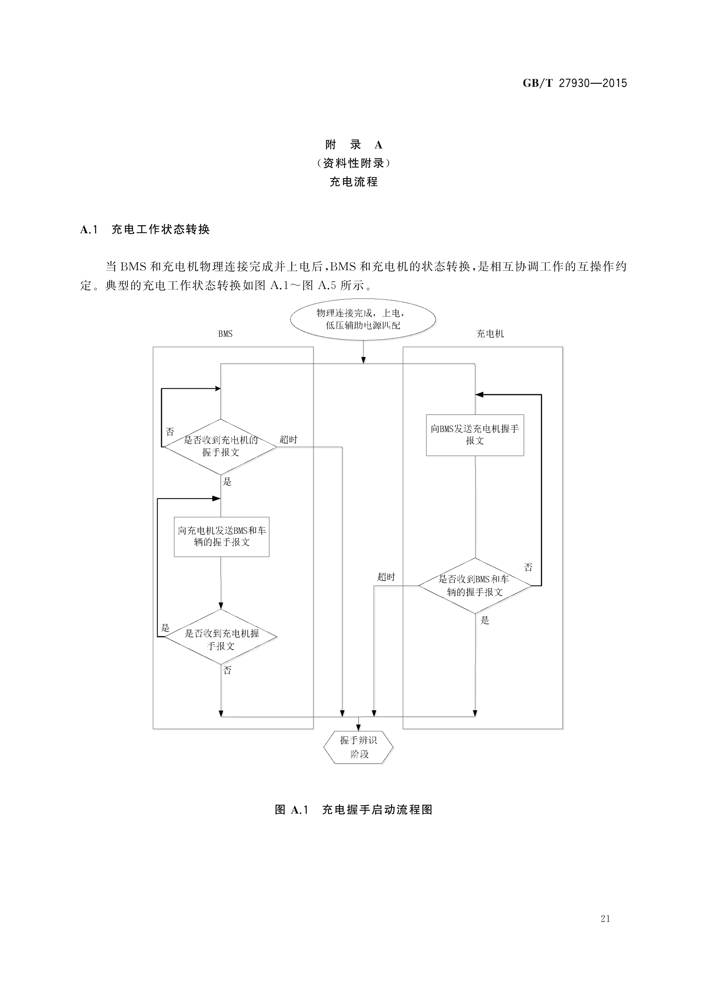

**流程文字化**（起点：物理连接完成、上电、低压辅助电源匹配）

| 侧 | 步骤 | 判断与分支 |
|---|---|---|
| BMS | ① 是否收到充电机的握手报文 | 否 / 超时 → 回到本判断循环；是 → 步骤② |
| BMS | ② 向充电机发送 BMS 和车辆的握手报文 | 完成后 → 步骤③ |
| BMS | ③ 是否收到充电机握手报文（对 BMS 握手报文的应答） | 否 → 回到本判断循环；是 → 握手辨识阶段 |
| 充电机 | ① 向 BMS 发送充电机握手报文 | 完成后 → 步骤② |
| 充电机 | ② 是否收到 BMS 和车辆的握手报文 | 否 / 超时 → 回到本判断循环；是 → 握手辨识阶段 |

**要点**：双方以"发送—校验—超时重判"的循环方式完成握手启动，校验通过后共同进入**握手辨识阶段**。

---

### 图 A.2 充电握手辨识流程图（原标准页 22）

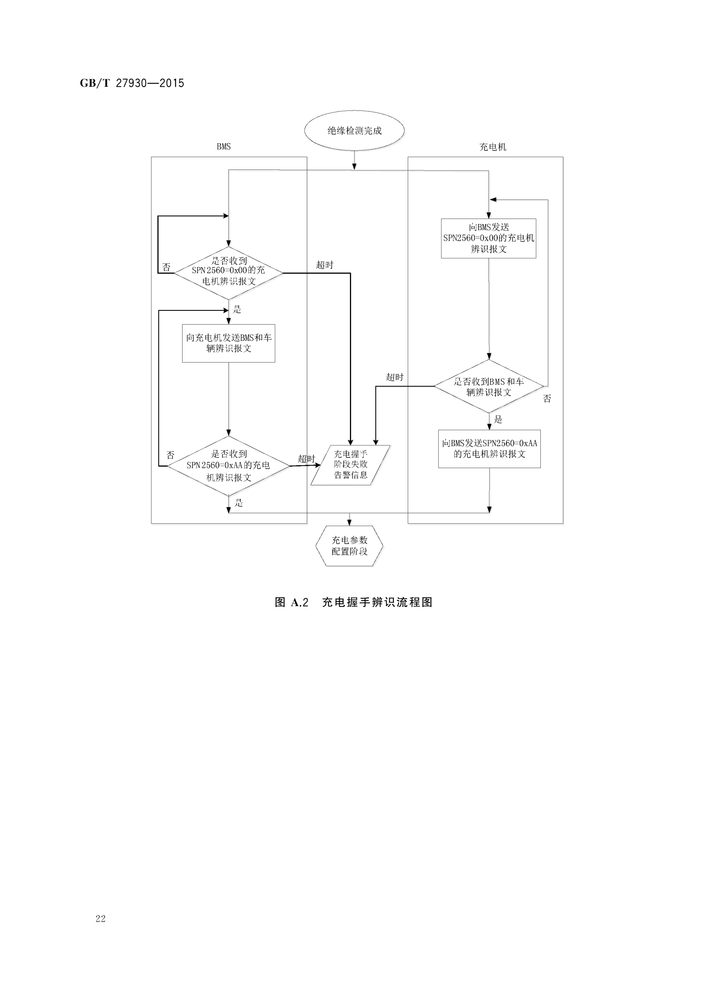

**流程文字化**（起点：绝缘检测完成）

| 侧 | 步骤 | 判断与分支 |
|---|---|---|
| BMS | ① 是否收到 SPN2560=0x00 的充电机辨识报文 | 否 → 循环；超时 → **充电握手阶段失败告警信息**；是 → 步骤② |
| BMS | ② 向充电机发送 BMS 和车辆辨识报文 | 完成后 → 步骤③ |
| BMS | ③ 是否收到 SPN2560=0xAA 的充电机辨识报文 | 超时 → **充电握手阶段失败告警信息**；是 → 充电参数配置阶段 |
| 充电机 | ① 向 BMS 发送 SPN2560=0x00 的充电机辨识报文 | 完成后 → 步骤② |
| 充电机 | ② 是否收到 BMS 和车辆辨识报文 | 否 / 超时 → 回到发送（循环）；是 → 步骤③ |
| 充电机 | ③ 向 BMS 发送 SPN2560=0xAA 的充电机辨识报文 | 完成后 → 充电参数配置阶段 |

**要点**：辨识阶段以 SPN2560 报文两次握手（先 0x00 后 0xAA）完成双方辨识，任何一侧超时即报"充电握手阶段失败"，通过后进入**充电参数配置阶段**。

---

### 图 A.3 充电参数配置阶段流程图（原标准页 23）

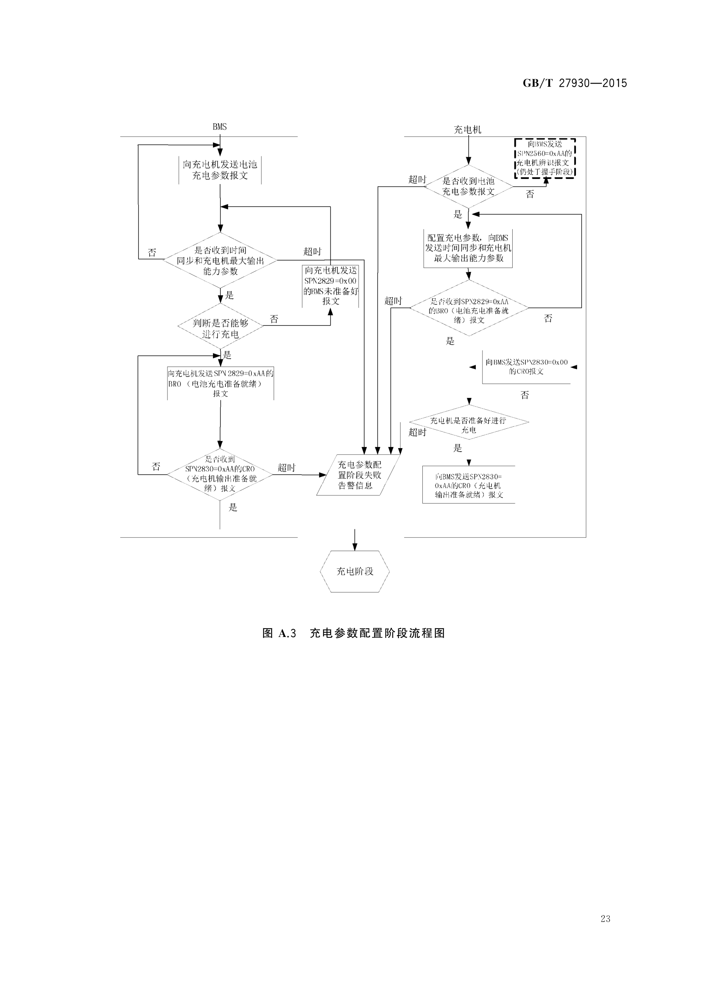

**流程文字化**（起点：进入参数配置阶段）

**BMS 侧：**

1. 向充电机发送电池充电参数报文。
2. 是否收到时间同步和充电机最大输出能力参数？
   - 否 → 循环重判；超时 → 向充电机发送 SPN2829=0x00 的 BMS 未准备好报文（回到循环）。
   - 是 → 步骤 3。
3. 判断是否能够进行充电。
   - 否 → 向充电机发送 SPN2829=0x00 的 BMS 未准备好报文（回到循环）。
   - 是 → 步骤 4。
4. 向充电机发送 SPN2829=0xAA 的 BRO（电池充电准备就绪）报文。
5. 是否收到 SPN2830=0xAA 的 CRO（充电机输出准备就绪）报文？
   - 否 → 循环重判；超时 → **充电参数配置阶段失败告警信息**。
   - 是 → **充电阶段**。

**充电机侧：**

1. 向 BMS 发送 SPN2560=0xAA 的充电机辨识报文（仍处于握手阶段）。
2. 是否收到电池充电参数报文？
   - 否 / 超时 → 回到发送（循环）。
   - 是 → 步骤 3。
3. 配置充电参数，向 BMS 发送时间同步和充电机最大输出能力参数。
4. 是否收到 SPN2829=0xAA 的 BRO（电池充电准备就绪）报文？
   - 否 / 超时 → 循环重判。
   - 是 → 步骤 5。
5. 向 BMS 发送 SPN2830=0x00 的 CRO 报文。
6. 充电机是否准备好进行充电？
   - 否 / 超时 → 回到发送 SPN2830=0x00 的 CRO 报文（循环）。
   - 是 → 步骤 7。
7. 向 BMS 发送 SPN2830=0xAA 的 CRO（充电机输出准备就绪）报文 → **充电阶段**。

**要点**：参数配置阶段完成"BMS 充电参数下发 → 充电机能力应答 → BRO/CRO 就绪互认"，任何一侧超时即报"充电参数配置阶段失败"。

---

### 图 A.4 充电阶段流程图（原标准页 24）

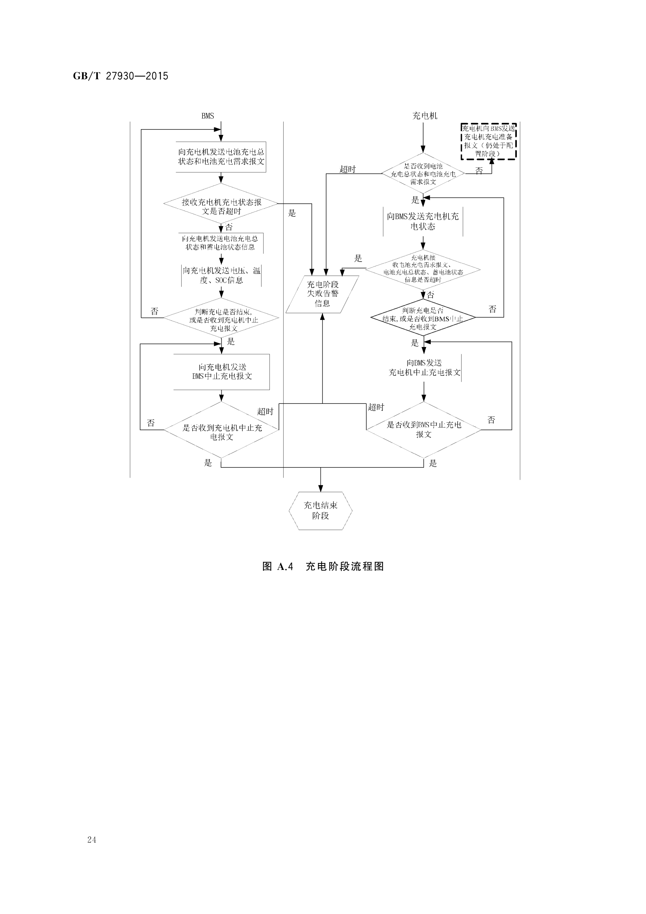

**流程文字化**

**BMS 侧：**

1. 向充电机发送电池充电总状态和电池充电需求报文。
2. 接收充电机充电状态报文是否超时？是 → **充电阶段失败告警信息**。
3. 向充电机发送电池充电总状态和蓄电池状态信息；向充电机发送电压、温度、SOC 信息。
4. 判断充电是否结束，或是否收到充电机中止充电报文？
   - 否 → 回到循环（重新发送状态/需求报文）。
   - 是 → 步骤 5。
5. 向充电机发送 BMS 中止充电报文。
6. 是否收到充电机中止充电报文？
   - 否 → 循环重判；超时 → **充电阶段失败告警信息**。
   - 是 → **充电结束阶段**。

**充电机侧：**

1. 充电机向 BMS 发送报文（仍处于配置阶段）。
2. 是否收到电池充电总状态和电池充电需求报文？
   - 否 → 循环重判。
   - 是 → 步骤 3。
3. 向 BMS 发送充电机充电状态。
4. 充电机接收电池充电需求报文、电池充电总状态、蓄电池状态信息是否超时？是 → **充电阶段失败告警信息**。
5. 判断充电是否结束，或是否收到 BMS 中止充电报文？
   - 否 → 回到循环。
   - 是 → 步骤 6。
6. 向 BMS 发送充电机中止充电报文。
7. 是否收到 BMS 中止充电报文？
   - 否 → 循环重判；超时 → **充电阶段失败告警信息**。
   - 是 → **充电结束阶段**。

**要点**：充电阶段双方持续交互"状态/需求报文 ↔ 充电状态"，任一方超时即报"充电阶段失败"；任一方判断应结束（收到对方中止报文或充电完成）即进入**充电结束阶段**。

---

### 图 A.5 充电结束阶段流程图（原标准页 25）

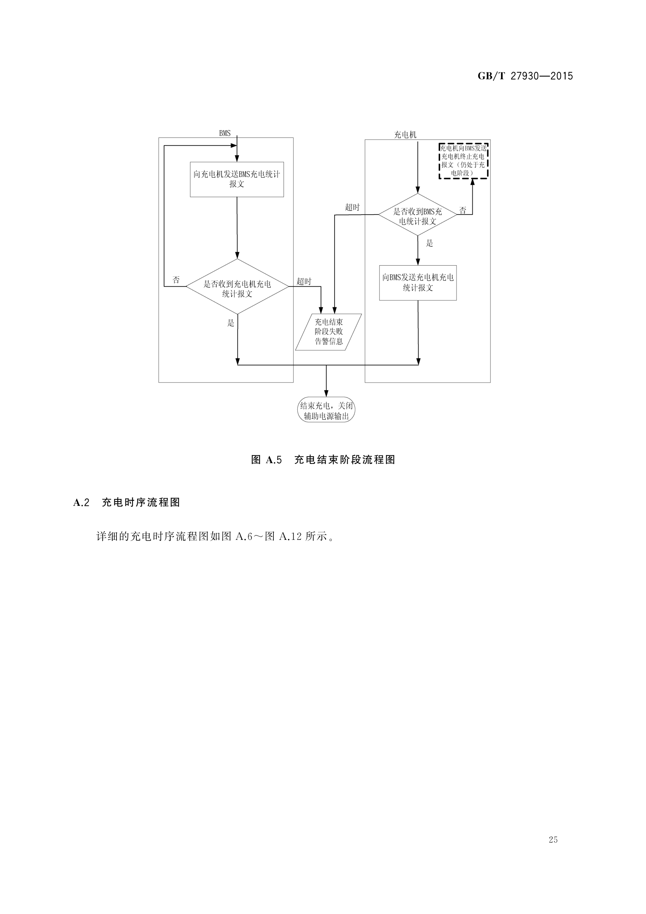

**流程文字化**

| 侧 | 步骤 | 判断与分支 |
|---|---|---|
| BMS | ① 向充电机发送 BMS 充电统计报文 | 完成后 → 步骤② |
| BMS | ② 是否收到充电机充电统计报文 | 否 → 循环重判；超时 → **充电结束阶段失败告警信息**；是 → 步骤③ |
| BMS | ③ 结束充电，关闭辅助电源输出 | 结束 |
| 充电机 | ① 充电机向 BMS 发送充电机终止充电报文（仍处于充电阶段） | 完成后 → 步骤② |
| 充电机 | ② 是否收到 BMS 充电统计报文 | 否 → 循环重判；是 → 步骤③ |
| 充电机 | ③ 向 BMS 发送充电机充电统计报文 | 结束后，双方完成统计交互 |

**要点**：充电结束阶段完成"BMS 充电统计 ↔ 充电机充电统计"互换，超时报"充电结束阶段失败"；BMS 侧最后结束充电并关闭辅助电源输出。

---

## A.2 充电时序流程图

> 详细的充电时序流程图如图 A.6～图 A.12 所示。

### 图 A.6 正常充电时序流程图（原标准页 26～31，共 6 页）

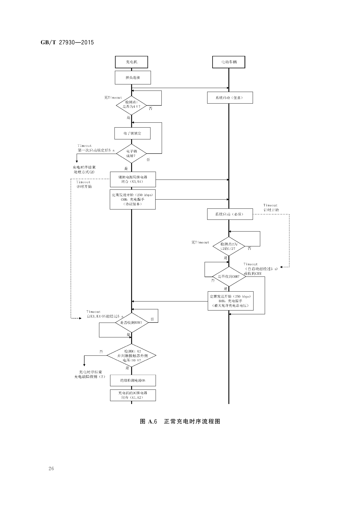

**第 1 部分（对应原标准页 26）：插头连接、电子锁、握手报文**

| 侧 | 步骤 | 判断与分支 |
|---|---|---|
| 充电机 | 插头连接 → 检测点 1 是否为 4 V？ | 无 Timeout；否 → 循环检测；是 → 电子锁锁定 |
| 充电机 | 电子锁锁定 → 电子锁就绪？ | 否 → 循环；**Timeout：第一次启动锁定后 5 s → 充电时序结束处理方式(2)**；是 → 辅助电源用继电器闭合（K3、K4） |
| 充电机 | 辅助电源用继电器闭合（K3、K4）→ **Timeout 计时开始** | → 定期发送开始（250 kbps）CHM：充电握手（协议版本） |
| 充电机 | 是否收到 BRM？ | **Timeout：自 K3、K4 ON 起经过 5 s**；否 → 回到循环等待；是 → 检测 K1、K2 并判断接触器外侧电压 < 10 V？ |
| 充电机 | 接触器外侧电压 < 10 V？ | 否 → **充电时序结束，充电故障级别(2)**；是 → 绝缘检测电路 ON → 充电机的 DC 继电器闭合（K1、K2） |
| 车辆 | 系统启动（任意）→ 检测点 2 为 L2 的 1/2？ | 无 Timeout；否 → 循环；是 → 是否收到 CHM？ |
| 车辆 | 是否收到 CHM？ | **Timeout（自启动起经过 5 s）或收到 CRM** → 否 → 循环；是 → 定期发送开始（250 kbps）BRM：充电握手（最大允许充电总电压） |
| 车辆 | 系统启动（必须）→ **Timeout 计时开始（60 s）** | 作为后续接收 CRM 的总时限依据（见第 2 部分"自收到 CIM 起 30 s 或者系统启动（必须）60 s"） |

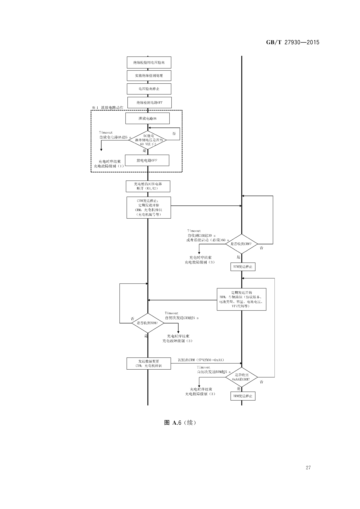

**第 2 部分（对应原标准页 27）：绝缘检测、辨识报文交互**

| 侧 | 步骤 | 判断与分支 |
|---|---|---|
| 充电机 | 绝缘校验用电压输出 → 实施绝缘检测处理 → 电压输出停止 → 绝缘检测电路 OFF | → 泄放电路 ON（※1 泄放电路动作） |
| 充电机 | DC 继电器外侧电压是否为 60 V 以下？ | **Timeout：自放电电路 ON 起 5 s**；否 → **充电时序结束，充电故障级别(1)**；是 → 放电电路 OFF |
| 充电机 | 充电桩的 DC 继电器断开（K1、K2） | → CIM 发送停止；定期发送开始 CRM：充电机辨识（充电机编号等） |
| 车辆 | 是否收到 CRM？ | **Timeout：自收到 CIM 起 30 s 或者系统启动（必须）60 s**；否 → **充电时序结束，充电故障级别(3)**；是 → BRM 发送停止 |
| 车辆 | 定期发送开始 BRM：车辆辨识（协议版本、电池类型、容量、电池电压、VIN 代码等） | → 是否收到 BRM？ |
| 充电机 | 是否收到 BRM？ | **Timeout：自初次发送 CRM 起 5 s**；否 → **充电时序结束，充电故障级别(3)**；是 → 发送数据变更 CRM：充电机辨识 |
| 车辆 | 识别出 CRM（SPN2560=0xAA）→ 是否收到 0xAA 的 CRM？ | **Timeout：自初次发送 BRM 起 5 s**；否 → **充电时序结束，充电故障级别(3)**；是 → BRM 发送停止 |

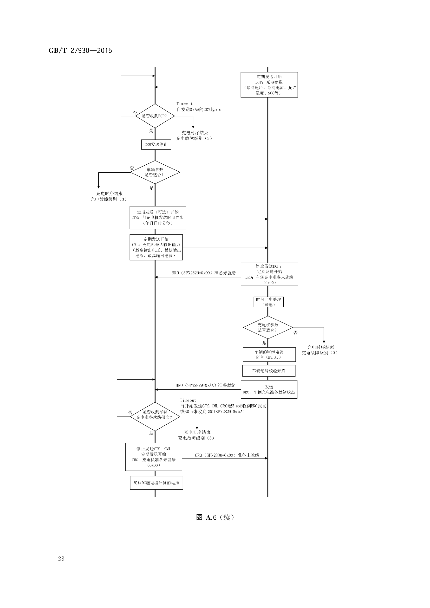

**第 3 部分（对应原标准页 28）：参数配置、准备就绪**

| 侧 | 步骤 | 判断与分支 |
|---|---|---|
| 充电机 | 定期发送开始 BCP：充电参数（最高电压、最高电流、允许温度、SOC 等） | → 是否收到 BCP？ |
| 车辆 | 是否收到 BCP？ | **Timeout：自发送 0xAA 的 CRM 起 5 s**；否 → **充电时序结束，充电故障级别(3)**、CRM 发送停止；是 → 车辆参数是否适合？ |
| 车辆 | 车辆参数是否适合？ | 否 → **充电时序结束，充电故障级别(3)**；是 → 定期发送（可选）开始 CTS：与充电机发送时间同步（年月日时分秒）；定期发送开始 CML：充电机最大输出能力（最高输出电压、最低输出电流、最高输出电流） |
| 充电机 | 停止发送 BCP；定期发送开始 BRO：车辆充电准备未就绪（0x00） | BRO（SPN2829=0x00）准备未就绪 |
| 充电机 | 时间同步处理（可选）→ 充电桩参数是否适合？ | 否 → **充电时序结束，充电故障级别(3)**；是 → 车辆的 DC 继电器闭合（K5、K6）→ 车辆绝缘校验开启 → 发送 BRO：车辆充电准备就绪状态（SPN2829=0xAA） |
| 车辆 | 是否收到车辆充电准备就绪报文？ | **Timeout：自开始发送 CTS、CML、CRO 起 5 s 未收到 BRO 报文，或 60 s 未收到 BRO（SPN2829=0xAA）**；否 → **充电时序结束，充电故障级别(3)**；是 → 停止发送 CTS、CML；定期发送开始 CRO：充电机准备未就绪（0x00） |
| 车辆 | 确认 DC 继电器外侧的电压 | 进入预充校验 |

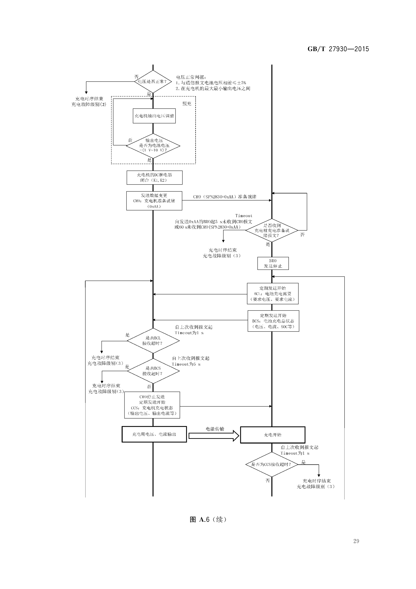

**第 4 部分（对应原标准页 29）：预充、正式充电**

| 侧 | 步骤 | 判断与分支 |
|---|---|---|
| 充电机 | 电压是否正常？ | 电压正常判据：① 与通信报文电池电压相差 ≤ ±5%；② 在充电机的最大/最小输出电压之间。否 → **充电时序结束，充电故障级别(2)**；是 → 预充 |
| 充电机 | 预充 → 充电机输出电压调整 → 输出电压是否为电池电压 −(1 V~10 V)？ | 否 → 循环调整；是 → 充电机的 DC 继电器闭合（K1、K2） |
| 充电机 | 发送数据变更 CRO：充电机准备就绪（0xAA） | CRO（SPN2830=0xAA）准备就绪 |
| 车辆 | 是否收到充电桩充电准备就绪报文？ | **Timeout：自发送 0xAA 的 BRO 起 5 s 未收到 CRO 报文，或 60 s 未收到 CRO（SPN2830=0xAA）**；否 → **充电时序结束，充电故障级别(3)**、BRO 发送停止；是 → 定期发送开始 BCL：电池充电需要（要求电压、要求电流）；定期发送开始 BCS：电池充电总状态（电压、电流、SOC 等） |
| 充电机 | 是否 BCL 接收超时？ | **Timeout：自上次收到报文起 1 s**；是 → **充电时序结束，充电故障级别(3)**；否 → 是否 BCS 接收超时？ |
| 充电机 | 是否 BCS 接收超时？ | **Timeout：自上次收到报文起 5 s**；是 → **充电时序结束，充电故障级别(3)**；否 → CRO 停止发送；定期发送开始 CCS：充电机充电状态（输出电压、输出电流等） |
| 充电机 | 充电用电压、电流输出 → **电能传输** | 车辆侧：充电开始 |
| 充电机 | 是否为 CCS 接收超时？ | **Timeout：自上次收到报文起 1 s**；是 → **充电时序结束，充电故障级别(3)**；否 → 进入充电运行 |

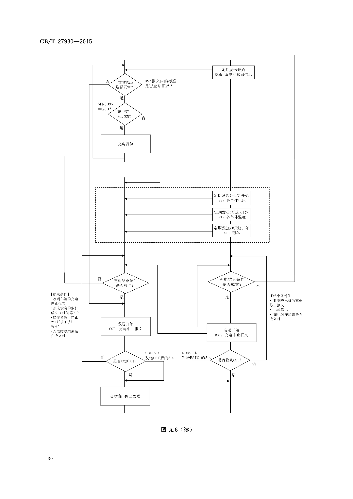

**第 5 部分（对应原标准页 30）：运行状态报文与充电结束判断**

| 侧 | 步骤 | 判断与分支 |
|---|---|---|
| 充电机 | 电池状态是否正常？（BSM 报文内的标签是否全部正常？） | 否 → 循环检测；是 → SPN3096=0x00？（充电禁止标志 ON？） |
| 充电机 | 充电禁止标志 ON？ | 否 → 正常充电；是 → **充电暂停** |
| 车辆 | 定期发送开始 BSM：蓄电池状态信息；定期发送（可选）开始 BMV：各单体电压、BMT：各单体温度、BSP：预备 | 持续发送 |
| 充电机 | 充电结束条件是否成立？ | 否 → 循环；是 → 发送开始 CST：充电中止报文 |
| 车辆 | 充电结束条件是否成立？ | 否 → 循环；是 → 发送开始 BST：充电中止报文 |
| 充电机 | 是否收到 BST？ | **Timeout：发送 CST 后的 5 s**；否 → 循环；是 → **电力输出停止处理** |
| 车辆 | 是否收到 CST？ | **Timeout：发送 BST 后的 5 s**；否 → 循环；是 → **电力输出停止处理** |

> 图中【结束条件】：
> - 充电机侧：收到车辆的充电停止报文；预先设定的条件成立（时间等）；操作者做出停止处理（按下按钮等）；充电时序结束条件成立。
> - 车辆侧：收到充电桩的充电停止报文；电池满电；充电时序结束条件成立。

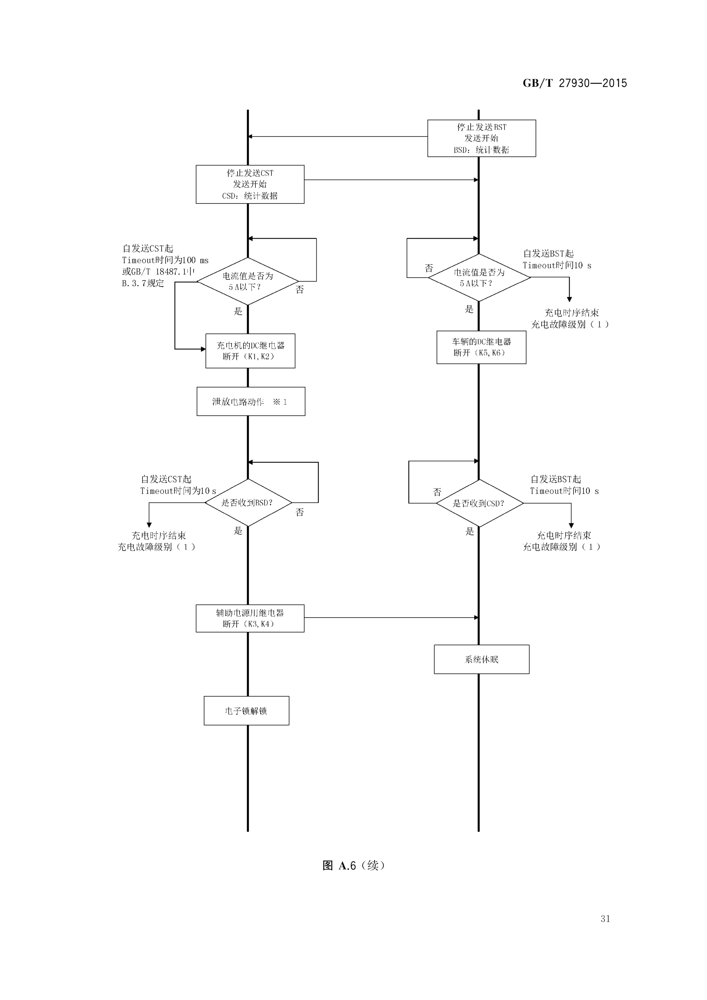

**第 6 部分（对应原标准页 31）：充电停止、统计与休眠**

| 侧 | 步骤 | 判断与分支 |
|---|---|---|
| 充电机 | 停止发送 CST；发送开始 CSD：统计数据 | → 电流值是否为 5 A 以下？ |
| 充电机 | 电流值是否为 5 A 以下？ | **Timeout：自发送 CST 起 100 ms 或 GB/T 18487.1 中 B.3.7 规定**；否 → 循环；是 → 充电器的 DC 继电器断开（K1、K2）→ 泄放电路动作 ※1 |
| 充电机 | 是否收到 BSD？ | **Timeout：自发送 CST 起 10 s**；否 → **充电时序结束，充电故障级别(1)**；是 → 辅助电源用继电器断开（K3、K4）→ 电子锁解锁 |
| 车辆 | 停止发送 BST；发送开始 BSD：统计数据 | → 电流值是否为 5 A 以下？ |
| 车辆 | 电流值是否为 5 A 以下？ | **Timeout：自发送 BST 起 10 s**；否 → **充电时序结束，充电故障级别(1)**；是 → 车辆的 DC 继电器断开（K5、K6） |
| 车辆 | 是否收到 CSD？ | **Timeout：自发送 BST 起 10 s**；否 → **充电时序结束，充电故障级别(1)**；是 → **系统休眠** |

**图 A.6 要点**：正常充电时序覆盖"插头连接 → 电子锁 → 握手/辨识（CHM/CRM/BRM）→ 参数配置（BCP/CTS/CML/BRO/CRO）→ 预充 → 电能传输（BCL/BCS/CCS/BSM）→ 中止（CST/BST）→ 统计（CSD/BSD）→ 继电器断开、电子锁解锁、系统休眠"的完整链路，各环节超时按故障级别 (1)(2)(3) 处理。

---

### 图 A.7 在非正常状态下停止（充电机方面的原因）流程图（原标准页 32）

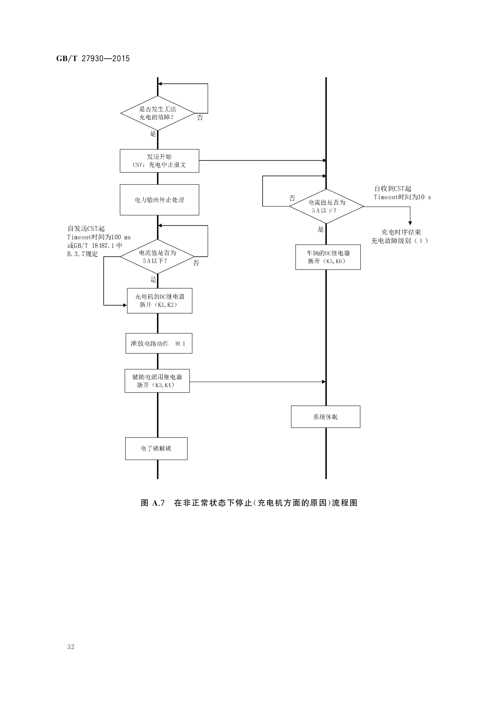

**流程文字化**

**充电机侧：**

1. 是否发生无法充电的故障？否 → 循环；是 → 步骤 2。
2. 发送开始 CST：充电中止报文 → 电力输出停止处理。
3. 电流值是否为 5 A 以下？
   - 否 → 循环；**Timeout：自发送 CST 起 100 ms 或 GB/T 18487.1 中 B.3.7 规定**。
   - 是 → 步骤 4。
4. 充电机的 DC 继电器断开（K1、K2）→ 泄放电路动作 ※1 → 辅助电源用继电器断开（K3、K4）→ 电子锁解锁。

**车辆侧：**

1. 电流值是否为 5 A 以下？否 → 循环；**Timeout：自收到 CST 起 10 s → 充电时序结束，充电故障级别(Ⅰ)**；是 → 步骤 2。
2. 车辆的 DC 继电器断开（K5、K6）→ **系统休眠**。

---

### 图 A.8 在非正常状态下停止（车辆方面的原因）流程图（原标准页 33）

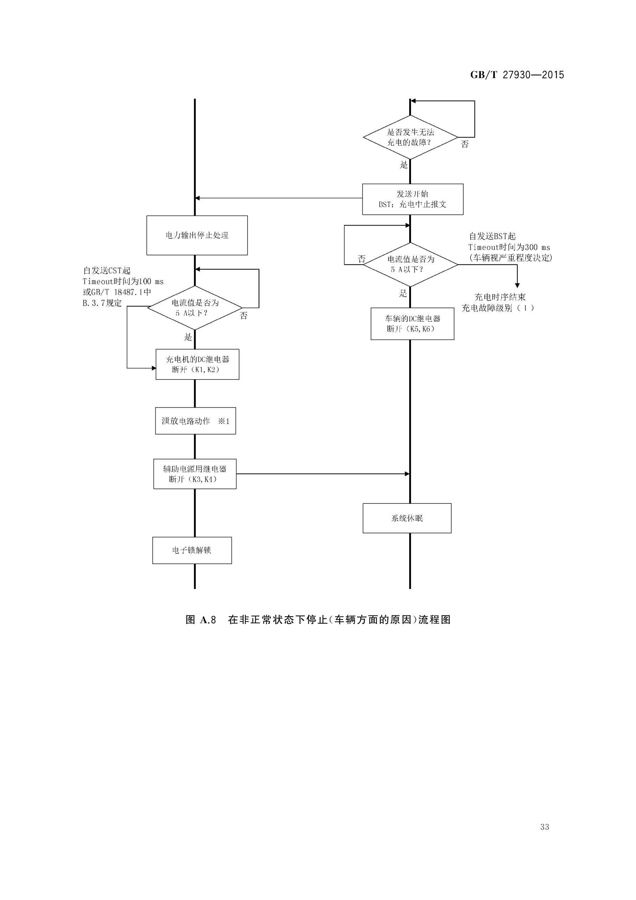

**流程文字化**

**车辆侧：**

1. 是否发生无法充电的故障？否 → 循环；是 → 步骤 2。
2. 发送开始 BST：充电中止报文。
3. 电流值是否为 5 A 以下？
   - 否 → **充电时序结束，充电故障级别(Ⅰ)**；**Timeout：自发送 BST 起 300 ms（车辆视严重程度决定）**。
   - 是 → 步骤 4。
4. 车辆的 DC 继电器断开（K5、K6）。

**充电机侧（收到 BST 后的响应）：**

1. 电力输出停止处理。
2. 电流值是否为 5 A 以下？否 → 循环；**Timeout：自发送 CST 起 100 ms 或 GB/T 18487.1 中 B.3.7 规定**；是 → 步骤 3。
3. 充电机的 DC 继电器断开（K1、K2）→ 泄放电路动作 ※1 → 辅助电源用继电器断开（K3、K4）→ 电子锁解锁。

> 车辆侧与充电机侧汇合 → **系统休眠**。

---

### 图 A.9 通信中断：通信超时重连 3 次后仍发生通信超时通信中止流程图（原标准页 34）

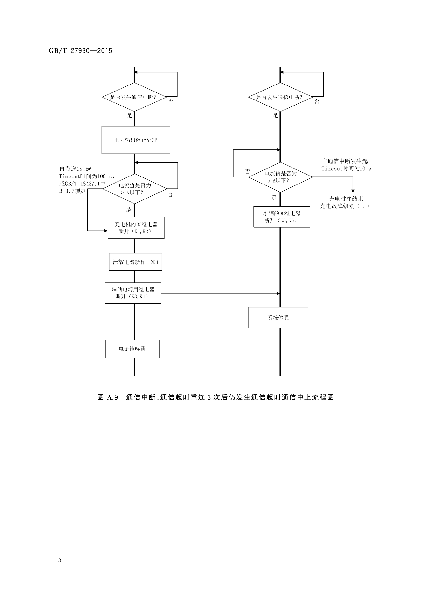

**流程文字化**

**充电机侧：**

1. 是否发生通信中断？否 → 循环；是 → 步骤 2。
2. 电力输出停止处理。
3. 电流值是否为 5 A 以下？否 → 循环；**Timeout：自发送 CST 起 100 ms 或 GB/T 18487.1 中 B.3.7 规定**；是 → 步骤 4。
4. 充电机的 DC 继电器断开（K1、K2）→ 泄放电路动作 ※1 → 辅助电源用继电器断开（K3、K4）→ 电子锁解锁。

**车辆侧：**

1. 是否发生通信中断？否 → 循环；是 → 步骤 2。
2. 电流值是否为 5 A 以下？否 → 循环；**Timeout：自通信中断发生起 10 s → 充电时序结束，充电故障级别(1)**；是 → 步骤 3。
3. 车辆的 DC 继电器断开（K5、K6）→ **系统休眠**。

---

### 图 A.10 S 开关开流程图（原标准页 35）

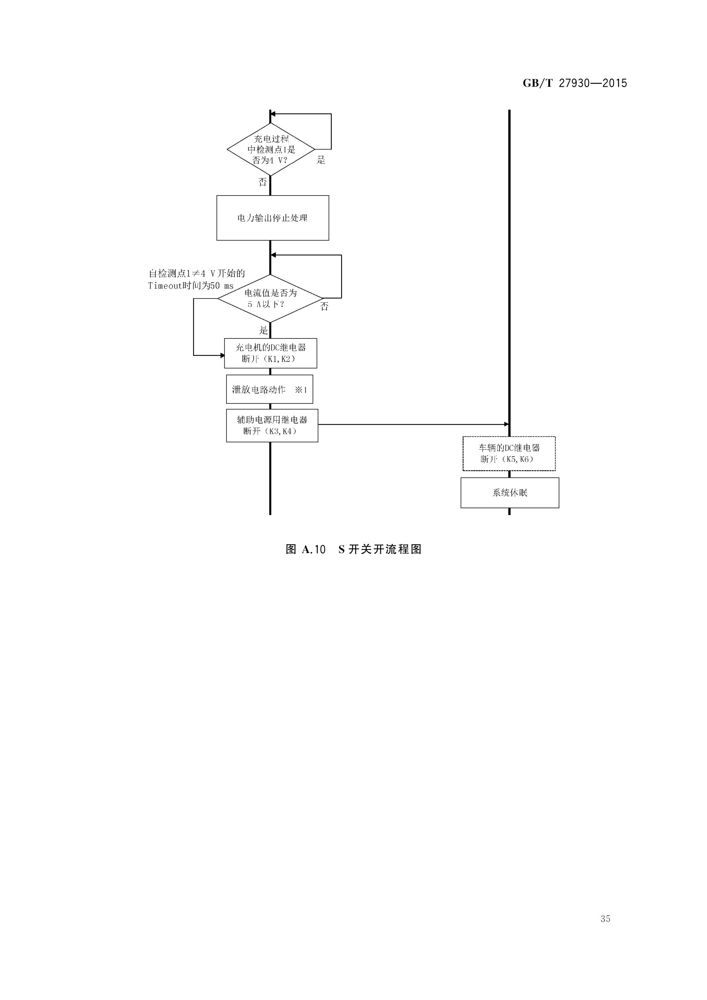

**流程文字化**

1. 充电过程中检测点 1 是否为 4 V？
   - 是 → 回到本判断循环（持续监测）。
   - 否 → 步骤 2。
2. 电力输出停止处理。
3. 电流值是否为 5 A 以下？否 → 循环；**Timeout：自检测点 1≠4 V 开始 50 ms**；是 → 步骤 4。
4. 充电机的 DC 继电器断开（K1、K2）→ 泄放电路动作 ※1 → 辅助电源用继电器断开（K3、K4）。
5. 车辆的 DC 继电器断开（K5、K6）→ **系统休眠**。

---

### 图 A.11 充电机接收 BMS 通信超时流程图（原标准页 36）

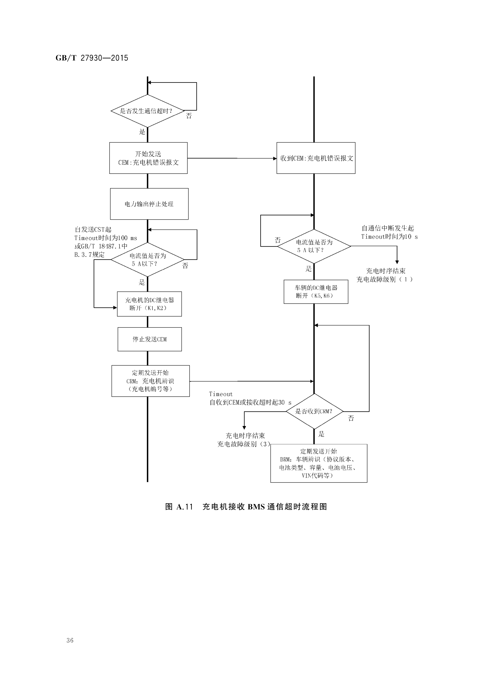

**流程文字化**

**充电机侧：**

1. 是否发生通信超时？否 → 循环；是 → 步骤 2。
2. 开始发送 CEM：充电机错误报文 → 电力输出停止处理。
3. 电流值是否为 5 A 以下？否 → 循环；**Timeout：自发送 CST 起 100 ms 或 GB/T 18487.1 中 B.3.7 规定**；是 → 步骤 4。
4. 充电机的 DC 继电器断开（K1、K2）→ 停止发送 CEM。
5. 定期发送开始 CRM：充电机辨识（充电机编号等）。
6. 是否收到 CRM？**Timeout：自收到 CEM 或接收超时起 30 s**；否 → **充电时序结束，充电故障级别(3)**；是 → 恢复辨识流程。

**车辆侧（收到 CEM 后的响应）：**

1. 收到 CEM：充电机错误报文。
2. 电流值是否为 5 A 以下？否 → 循环；**Timeout：自通信中断发生起 10 s → 充电时序结束，充电故障级别(1)**；是 → 步骤 3。
3. 车辆的 DC 继电器断开（K5、K6）。
4. 是否收到 CRM？否 → 循环；是 → 定期发送开始 BRM：车辆辨识（协议版本、电池类型、容量、电池电压、VIN 代码等），恢复辨识流程。

---

### 图 A.12 BMS 接收充电机通信超时流程图（原标准页 37）

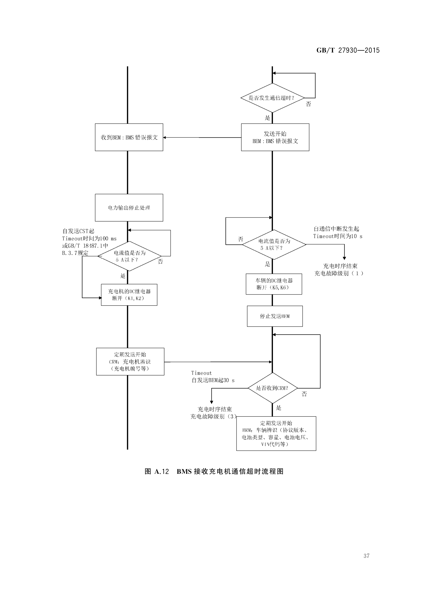

**流程文字化**

**车辆侧（BMS）：**

1. 是否发生通信超时？否 → 循环；是 → 步骤 2。
2. 发送开始 BEM：BMS 错误报文。
3. 电流值是否为 5 A 以下？否 → 循环；**Timeout：自通信中断发生起 10 s → 充电时序结束，充电故障级别(1)**；是 → 步骤 4。
4. 车辆的 DC 继电器断开（K5、K6）→ 停止发送 BEM。
5. 是否收到 CRM（充电机辨识报文）？否 → 循环等待；是 → 步骤 6。
6. 定期发送开始 BRM：车辆辨识（协议版本、电池类型、容量、电池电压、VIN 代码等），恢复辨识流程。

**充电机侧（收到 BEM 后的响应）：**

1. 收到 BEM：BMS 错误报文。
2. 电力输出停止处理。
3. 电流值是否为 5 A 以下？否 → 循环；**Timeout：自发送 CST 起 100 ms 或 GB/T 18487.1 中 B.3.7 规定**；是 → 步骤 4。
4. 充电机的 DC 继电器断开（K1、K2）。
5. 定期发送开始 CRM：充电机辨识（充电机编号等）。
6. 是否收到 CRM（车辆的 BRM 应答）？**Timeout：自发送 BEM 起 30 s**；否 → **充电时序结束，充电故障级别(3)**；是 → 恢复辨识流程。

---

## 附注（整理说明）

1. 本整理稿中"※1 泄放电路动作"为原图脚注标记，具体技术要求引用 GB/T 18487.1 相关规定（原图中未展开）。
2. 图内超时时间与故障级别标注均按原图原文转述；故障级别的具体含义与处理方式见标准正文及附录 C（本整理稿仅覆盖附录 A）。
3. 图 A.6 在原标准中占 6 页（原标准页 26 为首页，页 27～31 为 5 页续页），本稿按版面顺序分段整理，各段之间按箭头衔接。
4. 全部 17 幅原图裁剪件位于 `appendixA_pages/` 目录（`fig_A1.png`～`fig_A12.png`，其中 `fig_A6_1`～`fig_A6_6` 为图 A.6 的 6 个版面），与本文件同级，可对照查阅。
