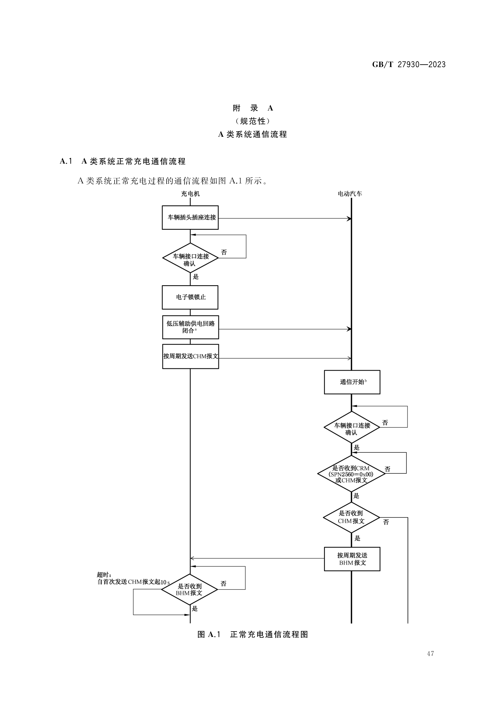
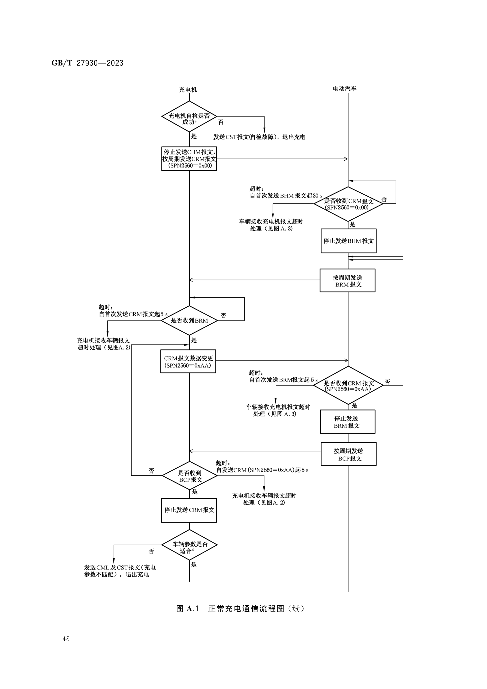
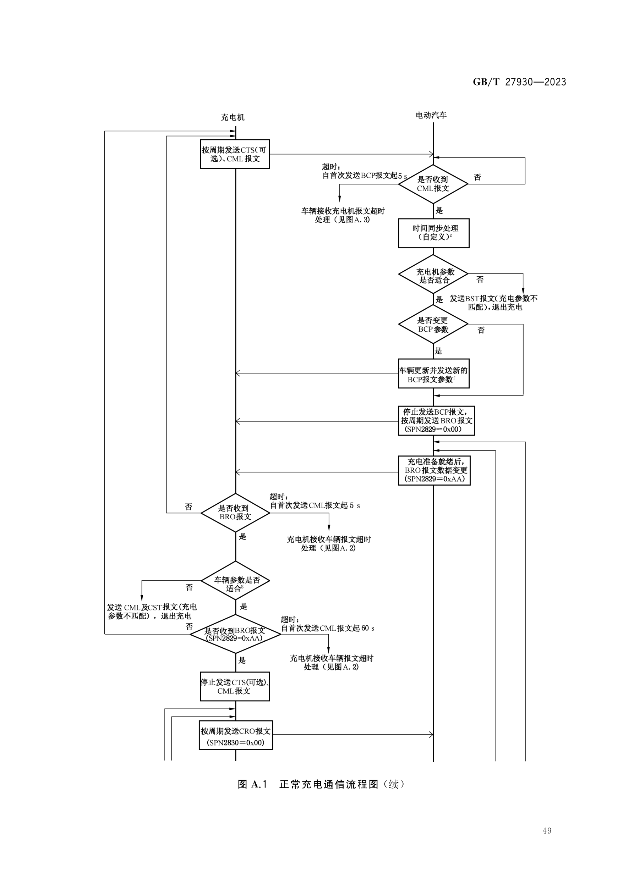
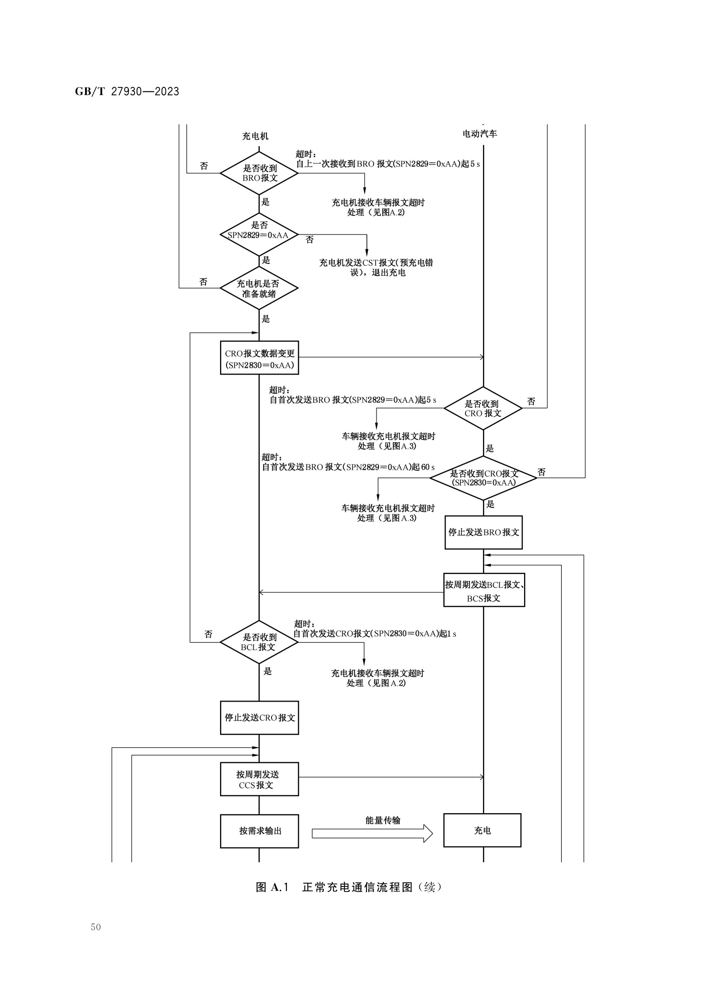
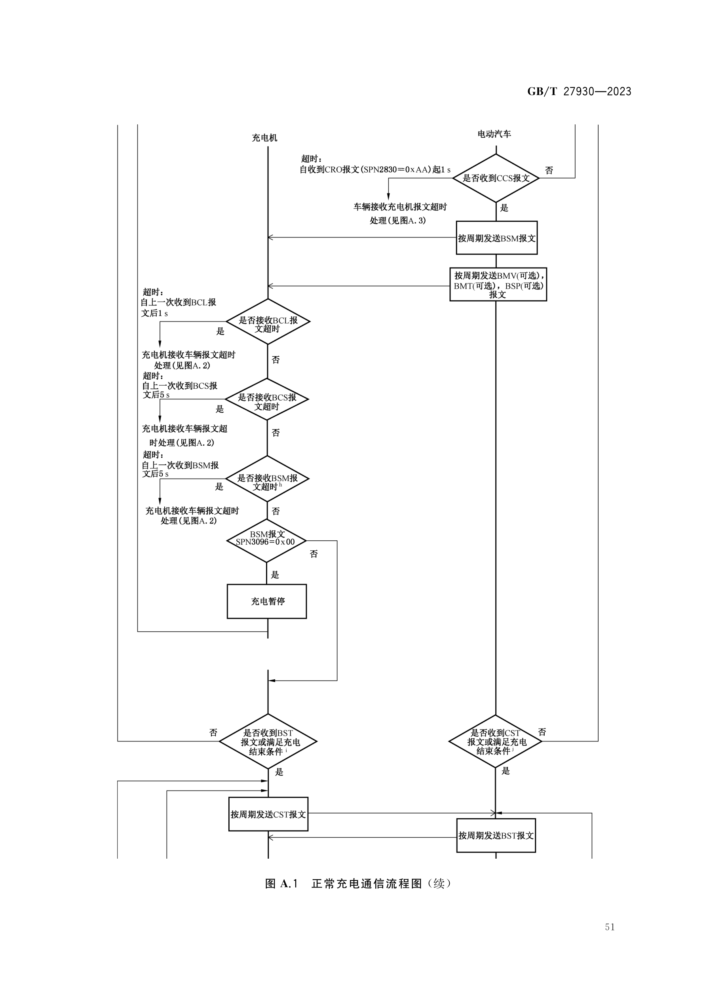
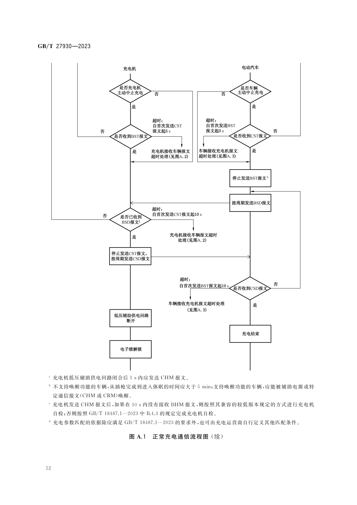
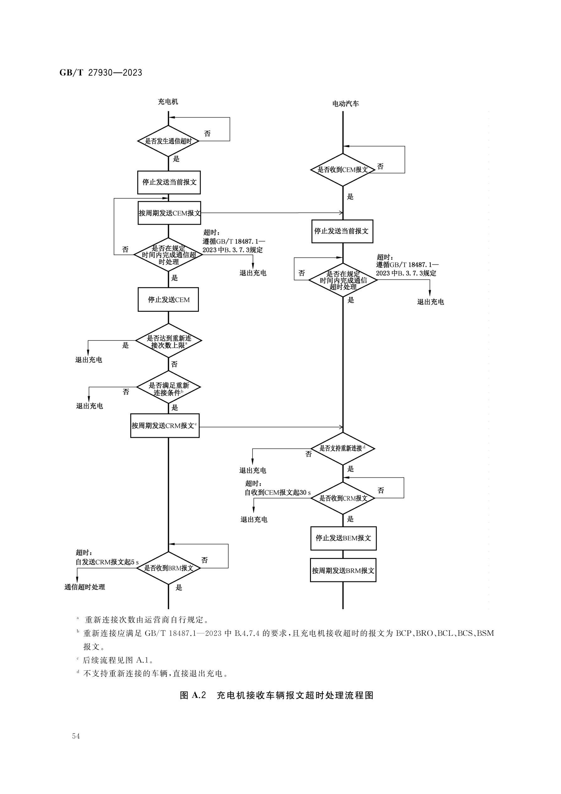
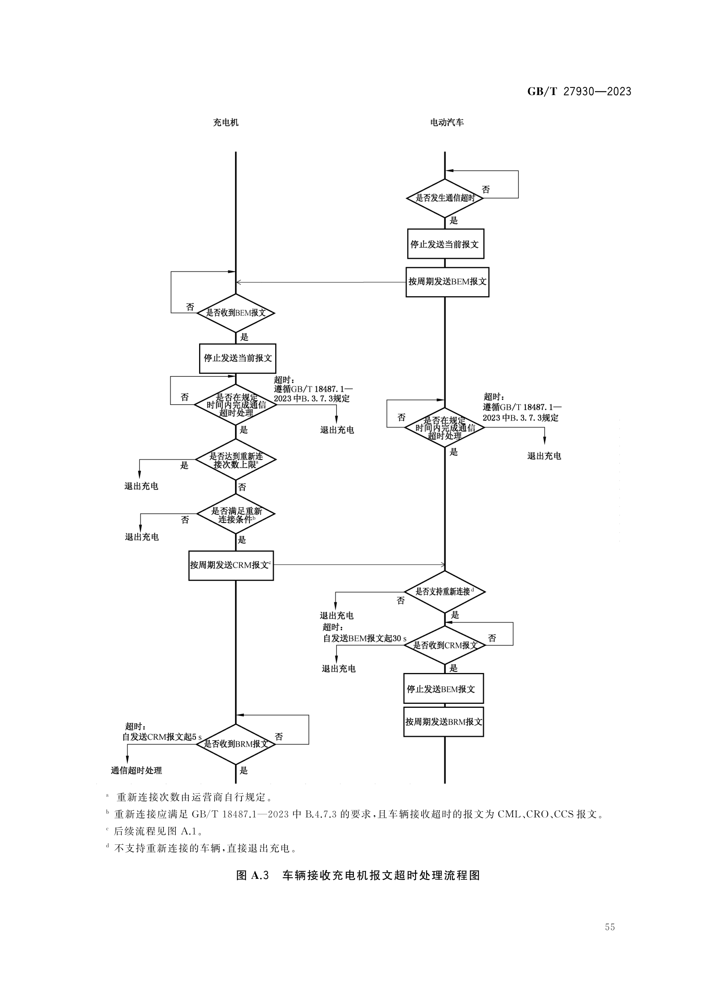

# GB/T 27930—2023 A 类系统协议整理：报文定义与通信流程

> **标准名称**：非车载传导式充电机与电动汽车之间的数字通信协议
> **整理内容**：A 类系统报文定义（第 10、11 章，标准页 7～22）+ 附录 A A 类系统通信流程（规范性附录，标准页 47～55）
> **来源文件**：`GBT 27930-2023 非车载传导式充电机与电动汽车之间的通信协议.PDF`
> **整理方式**：原文件为扫描版（无文本层），逐页渲染识别整理，各图附原图裁剪件，可对照查阅
> **说明**：2023 版附录 A 对应 A 类系统（采用 GB/T 18487.1—2023 附录 B 规定的充电系统）通信流程，为规范性内容；B 类系统流程见标准正文第 101～106 章及其他附录

**内容结构**

- [第一部分 报文定义](#第一部分-报文定义)（第 10 章报文分类总表 + 第 11 章报文格式与字段定义）
- [第二部分 附录 A A 类系统通信流程](#a1-a-类系统正常充电通信流程)（规范性附录 A，图 A.1～图 A.3）

---

## 第一部分 报文定义（A 类系统，第 10 章报文分类 + 第 11 章报文格式）

> 2023 版 A 类系统报文体系共 23 种报文，按五个阶段/类别组织：充电握手阶段（CHM/BHM/CRM/BRM）、参数配置阶段（BCP/CTS/CML/BRO/CRO）、充电阶段（BCL/BCS/CCS/BSM/BMV/BMT/BSP/BST/CST）、充电结束阶段（BSD/CSD）与错误报文（BEM/CEM）。报文方向中"车辆"即电动汽车（EVCC，含 BMS）。

### 1.1 报文分类总表（表 3～表 7）

**表 3 充电握手阶段报文分类**

| 报文代号 | 报文名称 | PGN(Dec) | PGN(Hex) | 优先权 | 数据长度 byte | 报文周期 | 源地址-目的地址 |
|---|---|---|---|---|---|---|---|
| CHM | 充电机握手报文 | 9728 | 002600H | 6 | 3 | 250 ms | 充电机-车辆 |
| BHM | 车辆握手报文 | 9984 | 002700H | 6 | 2 | 250 ms | 车辆-充电机 |
| CRM | 充电机辨识报文 | 256 | 000100H | 6 | 8 | 250 ms | 充电机-车辆 |
| BRM | BMS和车辆辨识报文 | 512 | 000200H | 7 | 49 | 250 ms | 车辆-充电机 |

**表 4 充电参数配置阶段报文分类**

| 报文代号 | 报文名称 | PGN(Dec) | PGN(Hex) | 优先权 | 数据长度 byte | 报文周期 | 源地址-目的地址 |
|---|---|---|---|---|---|---|---|
| BCP | 车辆充电参数报文 | 1536 | 000600H | 7 | 13 | 500 ms | 车辆-充电机 |
| CTS | 充电机发送时间同步信息报文 | 1792 | 000700H | 6 | 7 | 500 ms | 充电机-车辆 |
| CML | 充电机最大输出能力报文 | 2048 | 000800H | 6 | 8 | 250 ms | 充电机-车辆 |
| BRO | 车辆充电准备就绪状态报文 | 2304 | 000900H | 4 | 1 | 250 ms | 车辆-充电机 |
| CRO | 充电机输出准备就绪状态报文 | 2560 | 000A00H | 4 | 1 | 250 ms | 充电机-车辆 |

**表 5 充电阶段报文分类**

| 报文代号 | 报文名称 | PGN(Dec) | PGN(Hex) | 优先权 | 数据长度 byte | 报文周期 | 源地址-目的地址 |
|---|---|---|---|---|---|---|---|
| BCL | 电池充电需求报文 | 4096 | 001000H | 6 | 5 | 50 ms | 车辆-充电机 |
| BCS | 电池充电总状态报文 | 4352 | 001100H | 7 | 9 | 250 ms | 车辆-充电机 |
| CCS | 充电机充电状态报文 | 4608 | 001200H | 6 | 7 | 50 ms | 充电机-车辆 |
| BSM | 车辆状态信息报文 | 4864 | 001300H | 6 | 7 | 250 ms | 车辆-充电机 |
| BMV | 单体蓄电池电压报文 | 5376 | 001500H | 7 | 不定 | 10 000 ms | 车辆-充电机 |
| BMT | 动力蓄电池温度报文 | 5632 | 001600H | 7 | 不定 | 10 000 ms | 车辆-充电机 |
| BSP | 动力蓄电池预留报文 | 5888 | 001700H | 7 | 不定 | 10 000 ms | 车辆-充电机 |
| BST | 车辆中止充电报文 | 6400 | 001900H | 4 | 4 | 10 ms | 车辆-充电机 |
| CST | 充电机中止充电报文 | 6656 | 001A00H | 4 | 4 | 10 ms | 充电机-车辆 |

**表 6 充电结束阶段报文分类**

| 报文代号 | 报文名称 | PGN(Dec) | PGN(Hex) | 优先权 | 数据长度 byte | 报文周期 | 源地址-目的地址 |
|---|---|---|---|---|---|---|---|
| BSD | 车辆统计数据报文 | 7168 | 001C00H | 6 | 7 | 250 ms | 车辆-充电机 |
| CSD | 充电机统计数据报文 | 7424 | 001D00H | 6 | 8 | 250 ms | 充电机-车辆 |

**表 7 错误报文**

| 报文代号 | 报文名称 | PGN(Dec) | PGN(Hex) | 优先权 | 数据长度 byte | 报文周期 | 源地址-目的地址 |
|---|---|---|---|---|---|---|---|
| BEM | BMS及车辆错误报文 | 7680 | 001E00H | 2 | 4 | 250 ms | 车辆-充电机 |
| CEM | 充电机错误报文 | 7936 | 001F00H | 2 | 4 | 250 ms | 充电机-车辆 |

### 1.2 报文开始发送条件和结束发送条件（附录 B，表 B.1）

> 下表直接整理自原标准附录 B（资料性附录，printed page 56～57；对应 2015 版的附录 D），未做扩充。报文周期见 1.1 节分类总表；接收方超时阈值与超时后动作见第二部分附录 A 流程图（图 A.1～图 A.3）。

| 报文代号 | 开始发送条件 | 结束发送条件 |
|---|---|---|
| CHM | 低压辅助供电回路闭合 | 充电机自检完成准备发送 CRM |
| BHM | 接收 CHM 报文 | 接收 CRM（SPN2560=0x00）报文 |
| CRM | 充电机自检通过 | 接收 BCP 报文 |
| BRM | 接收 CRM 报文 | 接收 CRM（SPN2560=0xAA）报文 |
| BCP | 接收 CRM（SPN2560=0xAA）报文 | 接收 CML 报文ᵃ |
| BRO | 接收 CML 报文 | 发送 BRO（SPN2829=0xAA）报文，且接收 CRO（SPN2830=0xAA）报文 |
| CTS（可选） | 接收 BCP 报文 | 接收 BRO（SPN2829=0xAA）报文 |
| CML | 接收 BCP 报文 | 接收 BRO（SPN2829=0xAA）报文 |
| CRO | 接收 BRO（SPN2829=0xAA）报文 | 接收 BCL 和 BCS 报文 |
| BCL | 接收 CRO（SPN2830=0xAA）报文 | a）接收 CST 报文（充电机主动中止充电）；或 b）发送 BST 报文（车辆主动中止充电） |
| BCS | 接收 CRO（SPN2830=0xAA）报文 | a）接收 CST 报文（充电机主动中止充电）；或 b）发送 BST 报文（车辆主动中止充电） |
| CCS | 接收 BCL 报文 | a）接收 BST 报文（车辆主动中止充电）；或 b）发送 CST 报文（充电机主动中止充电） |
| BSM | 接收 CCS 报文 | a）接收 CST 报文（充电机主动中止充电）；或 b）发送 BST 报文（车辆主动中止充电） |
| BMV（可选） | 接收 CCS 报文 | a）接收 CST 报文（充电机主动中止充电）；或 b）发送 BST 报文（车辆主动中止充电） |
| BMT（可选） | 接收 CCS 报文 | a）接收 CST 报文（充电机主动中止充电）；或 b）发送 BST 报文（车辆主动中止充电） |
| BSP（可选） | 接收 CCS 报文 | a）接收 CST 报文（充电机主动中止充电）；或 b）发送 BST 报文（车辆主动中止充电） |
| BST | 1）车辆满足结束充电条件（车辆主动中止充电）；2）接收 CST 报文（充电机主动中止充电） | a）接收 CST 报文（车辆主动中止充电）；或 b）发送 5 包～10 包 BST 报文后（充电机主动中止充电） |
| CST | 1）充电机满足结束充电条件（充电机主动中止充电）；2）接收 BST 报文（车辆主动中止充电） | 接收 BSD 报文 |
| BSD | 1）接收 CST 报文（车辆主动中止充电）；或 2）发送 5 包～10 包 BST 报文后（充电机主动中止充电） | 接收 CSD 报文 |
| CSD | 接收 BSD 报文 | 关闭辅助电源 |
| BEM | 当车辆接收充电机报文超时 | 完成通信超时处理 |
| CEM | 当充电机接收车辆报文超时 | 完成通信超时处理 |

> ᵃ 车辆接收到 CML 报文，如需要更新 BCP 报文参数，宜至少再发送 2 帧更新参数后的 BCP 报文后发送 BRO（SPN2829=0x00）报文。

### 1.3 报文格式与字段定义（第 11 章，表 8～表 29）

#### 11.1 充电握手阶段报文

**PGN9728 充电机握手报文（CHM）**（表 8）
- 功能：充电机应在低压辅助供电回路闭合后 1 s 内发送第一帧 CHM，并按 250 ms 间隔周期发送，直到充电机自检结束或接收车辆中止充电报文；周期发送过程中 CHM 报文信息应一致。

| 起始字节或位 | 长度 | SPN | SPN 定义 | 发送选项 |
|---|---|---|---|---|
| 1 | 3 字节 | 2600 | 充电机通信协议版本号，本文件规定当前版本为 V1.1，表示为 byte3—00H；byte2—01H；byte1—01H | 必须项 |

**PGN9984 车辆握手报文（BHM）**（表 9）
- 功能：车辆接收 CHM 后按 250 ms 间隔周期发送；SPN2601 仅用于充电机进行绝缘自检时输出电缆绝缘监测电压依据（充电机自检应符合 GB/T 18487.1—2023 中 B.4.3）。

| 起始字节或位 | 长度 | SPN | SPN 定义 | 发送选项 |
|---|---|---|---|---|
| 1 | 2 字节 | 2601 | 车辆端绝缘监测允许总电压/V，0.1 V/位，0 V 偏移量 | 必须项 |

**PGN256 充电机辨识报文（CRM）**（表 10）
- 功能：充电机自检完成并通过后，停止发送 CHM，按 250 ms 周期发送 CRM。接收 BRM 报文前 SPN2560=0x00，接收后=0xAA。

| 起始字节或位 | 长度 | SPN | SPN 定义 | 发送选项 |
|---|---|---|---|---|
| 1 | 1 字节 | 2560 | 辨识结果（<0x00>：未辨识BMS及车辆信息；<0xAA>：已辨识BMS及车辆信息） | 必须项 |
| 2 | 4 字节 | 2561 | 充电机编号，1/位，0 偏移量，数据范围 0～0xFFFFFFFF | 必须项 |
| 6 | 3 字节 | 2562 | 充电机/充电站所在区域编码（由数字和大小写字母组成），标准 ASCII 码 | 可选项 |

**PGN512 BMS和车辆辨识报文（BRM）**（表 11）
- 功能：车辆接收 SPN2560=0x00 的 CRM 后按 250 ms 间隔周期发送，直到接收 SPN2560=0xAA 的 CRM 为止；参数组长度超出 8 字节，应使用传输协议功能传输（见 7.5）。

| 起始字节或位 | 长度 | SPN | SPN 定义 | 发送选项 |
|---|---|---|---|---|
| 1 | 3 字节 | 2565 | 车辆通信协议版本号，当前版本 V1.10，表示为 byte1=0x01，byte2=0x01，byte3=0x00 | 必须项 |
| 4 | 1 字节 | 2566 | 电池类型（01H 铅酸、02H 镍氢、03H 磷酸铁锂、04H 锰酸锂、05H 钴酸锂、06H 三元材料、07H 聚合物锂离子、08H 钛酸锂、FFH 其他） | 必须项 |
| 5 | 2 字节 | 2567 | 动力蓄电池系统额定容量/Ah，0.1 Ah/位，0 Ah 偏移量 | 必须项 |
| 7 | 2 字节 | 2568 | 动力蓄电池系统额定总电压/V，0.1 V/位，0 V 偏移量 | 必须项 |
| 9 | 4 字节 | 2569 | 电池生产厂商名称，标准 ASCII 码 | 可选项 |
| 13 | 4 字节 | 2570 | 电池组序号，预留，由厂商自行定义 | 可选项 |
| 17~19 | 3 字节 | 2571 | 电池组生产日期：年（1 年/位，1985 年偏移量，1985～2235 年）/ 月（1～12）/ 日（1～31） | 可选项 |
| 20 | 3 字节 | 2572 | 电池组充电次数，1 次/位，0 次偏移量，以 BMS 统计为准 | 可选项 |
| 23 | 1 字节 | 2573 | 电池组产权标识（<0>：=租赁；<1>：=车自有） | 可选项 |
| 24 | 1 字节 | 2574 | 预留 | 可选项 |
| 25 | 17 字节 | 2575 | 扩展车辆识别码（EVIN） | 可选项 |
| 42 | 8 字节 | 2576 | 车辆通信协议软件版本号（8 字节，16 进制编码：byte8~6 预留填 FFFFFFH；byte5、byte4 编译年；byte3 月；byte2 日；byte1 版本流水号） | 可选项 |

#### 11.2 参数配置阶段报文

**PGN1536 车辆充电参数报文（BCP）**（表 12）
- 功能：车辆接收 SPN2560=0xAA 的 CRM 后进入参数配置阶段，按 500 ms 间隔周期发送；参数组长度超出 8 字节应使用传输协议功能传输（见 7.5）；其中 SPN2819 可作为充电机过压保护的参考值。

| 起始字节或位 | 长度 | SPN | SPN 定义 | 发送选项 |
|---|---|---|---|---|
| 1 | 2 字节 | 2816 | 单体蓄电池最高允许充电电压/V（0.01 V/位，0 V 偏移量，0～24 V） | 必须项 |
| 3 | 2 字节 | 2817 | 最高允许充电电流/A（0.1 A/位，−400 A 偏移量） | 必须项 |
| 5 | 2 字节 | 2818 | 动力蓄电池标称总能量/kWh（0.1 kWh/位，0～1000 kWh） | 必须项 |
| 7 | 2 字节 | 2819 | 最高允许充电总电压/V（0.1 V/位，0 V 偏移量） | 必须项 |
| 9 | 1 字节 | 2820 | 单体蓄电池最高允许温度/℃（1 ℃/位，−50 ℃偏移量，−50～+200 ℃） | 必须项 |
| 10 | 2 字节 | 2821 | 整车荷电状态（SOC）（0.1%/位，0～100%） | 必须项 |
| 12 | 2 字节 | 2822 | 车辆接口当前电压测量值/V（0.1 V/位，0 V 偏移量） | 必须项 |

**PGN1792 充电机发送时间同步信息报文（CTS）**（表 13）
- 功能：充电机接收 BCP 后按 500 ms 间隔周期发送；车辆是否进行时间同步操作由自身工作模式或工作状况决定。

| 起始字节或位 | 长度 | SPN | SPN 定义 | 发送选项 |
|---|---|---|---|---|
| 1 | 7 字节 | 2823 | 年/月/日/时/分/秒（压缩 BCD 码：byte1 秒、byte2 分、byte3 时、byte4 日、byte5 月、byte6~7 年；如 2019-10-11 15:20:13 表示为 byte7—19H…byte1—13H） | 可选项 |

**PGN2048 充电机最大输出能力报文（CML）**（表 14）
- 功能：充电机接收 BCP 后按 250 ms 间隔周期发送，告知车辆其最大输出能力。

| 起始字节或位 | 长度 | SPN | SPN 定义 | 发送选项 |
|---|---|---|---|---|
| 1 | 2 字节 | 2824 | 充电机最高充电电压/V，0.1 V/位 | 必须项 |
| 3 | 2 字节 | 2825 | 充电机最低充电电压/V，0.1 V/位 | 必须项 |
| 5 | 2 字节 | 2826 | 充电机最大充电电流/A，0.1 A/位，−400 A 偏移量 | 必须项 |
| 7 | 2 字节 | 2827 | 充电机最小充电电流/A，0.1 A/位，−400 A 偏移量 | 必须项 |

**PGN2304 车辆充电准备就绪报文（BRO）**（表 15）
- 功能：充电参数配置成功后车辆按 250 ms 间隔周期发送；准备就绪前 SPN2829=0x00，就绪后=0xAA。充电机 5 s 内未接收 BRO，或 60 s 内未接收 BRO（SPN2829=0xAA）则为超时。

| 起始字节或位 | 长度 | SPN | SPN 定义 | 发送选项 |
|---|---|---|---|---|
| 1 | 1 字节 | 2829 | 车辆是否充电准备好（<0x00>：=未做好充电准备；<0xAA>：=完成充电准备；<0xFF>：=无效）（车辆在不能获知当前准备就绪状态时，为保证通信信道正常可发送无效值） | 必须项 |

**PGN2560 充电机输出准备就绪报文（CRO）**（表 16）
- 功能：充电机接收 SPN2829=0xAA 的 BRO 后按 250 ms 间隔周期发送；准备就绪前 SPN2830=0x00，就绪后=0xAA。车辆 5 s 内未接收 CRO，或 60 s 内未接收 CRO（SPN2830=0xAA）则为超时。

| 起始字节或位 | 长度 | SPN | SPN 定义 | 发送选项 |
|---|---|---|---|---|
| 1 | 1 字节 | 2830 | 充电机是否充电准备好（<0x00>：=未完成充电准备；<0xAA>：=完成充电准备；<0xFF>：=无效）（充电机在不能获知当前准备就绪状态时，为保证通信信道正常可发送无效值） | 必须项 |

#### 11.3 充电阶段报文

**PGN4096 电池充电需求报文（BCL）**（表 17）
- 功能：双方充电准备就绪后车辆按 50 ms 间隔周期发送；充电机充电阶段 1 s 内未接收即超时错误。恒压模式输出电压满足电压需求、输出电流不超过电流需求；恒流模式反之。电压需求＞CML 最高充电电压时限压；电流需求＞CML 最大充电电流时按最大能力输出；电流需求＜最小充电电流时按最小输出能力输出；电压需求＜最小充电电压时发送 CST 停止充电。充电需求电流应是车辆实际需求，不应受充电机输出能力变化影响。

| 起始字节或位 | 长度 | SPN | SPN 定义 | 发送选项 |
|---|---|---|---|---|
| 1 | 2 字节 | 3072 | 车辆接口充电电压需求/V，0.1 V/位 | 必须项 |
| 3 | 2 字节 | 3073 | 车辆接口充电电流需求/A（即输入至车辆充电插座的车辆充电电流总需求），0.1 A/位，−400 A 偏移量 | 必须项 |
| 5 | 1 字节 | 3074 | 充电模式（0x01：恒压充电；0x02：恒流充电） | 必须项 |

**PGN4352 电池充电总状态报文（BCS）**（表 18）
- 功能：充电过程中车辆按 250 ms 间隔周期发送当前充电电压、电流等状态；充电机超过 5 s 未接收即超时错误；参数组长度超出 8 字节应使用传输协议功能传输（见 7.5）。

| 起始字节或位 | 长度 | SPN | SPN 定义 | 发送选项 |
|---|---|---|---|---|
| 1 | 2 字节 | 3075 | 车辆接口当前电压测量值/V，0.1 V/位 | 必须项 |
| 3 | 2 字节 | 3076 | 车辆接口当前电流测量值/A，0.1 A/位，−400 A 偏移量 | 必须项 |
| 5 | 2 字节 | 3077 | 最高单体蓄电池电压及其组号（1~12 位电压 0.01 V/位 0～24 V；13~16 位组号 1/位 0～15） | 必须项 |
| 7 | 1 字节 | 3078 | 当前荷电状态（SOC）（1%/位，0～100%） | 必须项 |
| 8 | 2 字节 | 3079 | 估算剩余充电时间/min（1 min/位，0 min 偏移量） | 必须项 |

**PGN4608 充电机充电状态报文（CCS）**（表 19）
- 功能：充电过程中充电机按 50 ms 间隔周期发送当前充电电流、电压值；车辆超过 1 s 未接收即超时错误。

| 起始字节或位 | 长度 | SPN | SPN 定义 | 发送选项 |
|---|---|---|---|---|
| 1 | 2 字节 | 3081 | 车辆接口当前电压测量值/V，0.1 V/位 | 必须项 |
| 3 | 2 字节 | 3082 | 车辆接口当前电流测量值/A，0.1 A/位，−400 A 偏移量 | 必须项 |
| 5 | 2 字节 | 3083 | 累计充电时间/min（1 min/位，0～600 min） | 必须项 |
| 7.1 | 2 位 | 3929 | 充电允许（<00>：=暂停；<01>：=允许） | 必须项 |

> 注：CCS 中 SPN3929=0 表示充电机将暂停输出，=1 表示充电机将继续开始充电。

**PGN4864 车辆状态信息报文（BSM）**（表 20）
- 功能：充电阶段车辆按 250 ms 间隔周期发送动力蓄电池状态信息。为保证兼容性，充电机没有接收 BSM 之前，不应以 BSM 报文超时为由中止充电；接收 BSM 后超过 5 s 未接收即为超时错误，充电机应发送错误报文中止充电，且不应在未重新插拔枪的情况下重新握手。车辆可通过 SPN3096=0 请求暂停，暂停及恢复应满足 GB/T 18487.1—2023 中 B.4.5；暂停到恢复时间不应超过 10 min，恢复充电冲击电流应满足 GB/T 18487.1—2023 中 10.7.2。

| 起始字节或位 | 长度 | SPN | SPN 定义 | 发送选项 |
|---|---|---|---|---|
| 1 | 1 字节 | 3085 | 最高单体蓄电池电压所在编号（1/位，1 偏移量，1～256） | 必须项 |
| 2 | 1 字节 | 3086 | 当前单体蓄电池最高温度/℃（1 ℃/位，−50 ℃偏移量，−50～+200 ℃） | 必须项 |
| 3 | 1 字节 | 3087 | 最高动力蓄电池温度检测点编号（1/位，1 偏移量，1～128） | 必须项 |
| 4 | 1 字节 | 3088 | 当前单体蓄电池最低温度/℃（1 ℃/位，−50 ℃偏移量，−50～+200 ℃） | 必须项 |
| 5 | 1 字节 | 3089 | 最低动力蓄电池温度检测点编号（1/位，1 偏移量，1～128） | 必须项 |
| 6.1 | 2 位 | 3090 | 单体蓄电池电压过高/过低（<00>正常；<01>过高；<10>过低） | 必须项 |
| 6.3 | 2 位 | 3091 | 动力蓄电池荷电状态 SOC 过高/过低（<00>正常；<01>过高；<10>过低） | 必须项 |
| 6.5 | 2 位 | 3092 | 动力蓄电池充电过电流（<00>正常；<01>过流；<10>不可信状态） | 必须项 |
| 6.7 | 2 位 | 3093 | 动力蓄电池温度过高（<00>正常；<01>过高；<10>不可信状态） | 必须项 |
| 7.1 | 2 位 | 3094 | 动力蓄电池绝缘状态（<00>正常；<01>不正常；<10>不可信状态） | 必须项 |
| 7.3 | 2 位 | 3095 | 动力蓄电池组输出连接器连接状态（<00>正常；<01>不正常；<10>不可信状态） | 必须项 |
| 7.5 | 2 位 | 3096 | 充电允许（<00>：=禁止；<01>：=允许） | 必须项 |

> 注：SPN3090～3095 均为 00 且 SPN3096=00（禁止充电）时充电机暂停输出；均为 00 且 SPN3096=01 时恢复充电；3090～3095 至少一项异常或接收 BST 时，充电机应发送 CST 停止充电；车辆检测到电池状态异常时应发送 BST 结束充电。

**PGN5376 单体蓄电池电压报文（BMV）**（表 21）
- 功能：充电阶段车辆按 10 s 间隔周期发送单体蓄电池电压值；参数组长度超出 8 字节应使用传输协议功能传输（见 7.5）。

| 起始字节或位 | 长度 | SPN | SPN 定义 | 发送选项 |
|---|---|---|---|---|
| 1、3、5、7、9、11 … 509、511 | 2 字节/项 | 3101～3356 | #1～#256 单体蓄电池电压/V（1~12 位电压 0.01 V/位 0～24 V；13~16 位电池分组号） | 可选项 |

> 注：有分组号按实际分组号发送；无分组号按 256 个单体蓄电池为一组发送。

**PGN5632 动力蓄电池温度报文（BMT）**（表 22）
- 功能：充电阶段车辆按 10 s 间隔周期发送动力蓄电池温度值；参数组长度超出 8 字节应使用传输协议功能传输（见 7.5）。

| 起始字节或位 | 长度 | SPN | SPN 定义 | 发送选项 |
|---|---|---|---|---|
| 1、2、3 … 127、128 | 1 字节/项 | 3361～3488 | 动力蓄电池温度 1～128/℃（1 ℃/位，−50 ℃偏移量，−50～+200 ℃） | 可选项 |

**PGN5888 动力蓄电池预留报文（BSP）**（表 23）
- 功能：充电阶段车辆按 10 s 间隔周期发送动力蓄电池预留信息；参数组长度超出 8 字节应使用传输协议功能传输（见 7.5）。

| 起始字节或位 | 长度 | SPN | SPN 定义 | 发送选项 |
|---|---|---|---|---|
| 1～16 | 1 字节/项 | 3491～3506 | 动力蓄电池预留字段 1～16 | 可选项 |

> 注：在没有解决双边身份鉴权的情况下，BSP 报文只应用在私有场站，不在公共场站发送和接收处理 BSP 报文。

**PGN6400 车辆中止充电报文（BST）**（表 24）
- 功能：车辆主动中止充电或接收 CST 报文后，按 10 ms 间隔周期发送 BST，报文内容应与中止原因一致。通信开始后（车辆接收 CHM 后）的各个阶段，车辆都可发送 BST 主动中止充电；出现必须中止充电的异常或故障时应发送 BST。

| 起始字节或位 | 长度 | SPN | SPN 定义 | 发送选项 |
|---|---|---|---|---|
| 1 | 1 字节 | 3511 | 车辆中止充电原因 | 必须项 |
| 2 | 2 字节 | 3512 | 车辆中止充电故障原因 | 必须项 |
| 4 | 1 字节 | 3513 | 车辆中止充电错误原因 | 必须项 |

> SPN3511 位定义：第 1~2 位达到所需求的 SOC 目标值；第 3~4 位达到总电压的设定值；第 5~6 位达到单体电压的设定值；第 7~8 位充电机主动中止（接收 CST 帧）。
> SPN3512 位定义：第 1~2 位绝缘故障；第 3~4 位车辆插座过温故障；第 5~6 位车辆内部线束或相关连接器过温；第 7~8 位充电耦合器连接故障；第 9~10 位电池组温度过高故障；第 11~12 位高压继电器故障；第 13~14 位检测点 2 电压检测故障；第 15~16 位其他原因。
> SPN3513 位定义：第 1~2 位电流过大；第 3~4 位电压异常；第 5~6 位充电参数不匹配。各状态值均为 <00>正常 <01>故障/超限 <10>不可信状态。

**PGN6656 充电机中止充电报文（CST）**（表 25）
- 功能：充电机主动中止充电或接收 BST 报文后，按 10 ms 间隔周期发送 CST，报文内容应与中止原因一致。通信开始后（充电机发送 CHM 后）的各个阶段，充电机都可发送 CST 主动中止充电；出现必须中止充电的异常或故障时应发送 CST。

| 起始字节或位 | 长度 | SPN | SPN 定义 | 发送选项 |
|---|---|---|---|---|
| 1 | 1 字节 | 3521 | 充电机中止充电原因 | 必须项 |
| 2 | 2 字节 | 3522 | 充电机中止充电故障原因 | 必须项 |
| 4 | 1 字节 | 3523 | 充电机中止充电错误原因 | 必须项 |

> SPN3521 位定义：第 1~2 位达到充电机设定的条件中止（含按金额充电、按时间充电、按 SOC 充电等预先设置条件）；第 3~4 位人工中止（含通信开始后用户触发的主动中止）；第 5~6 位故障中止（含各类非正常中止）；第 7~8 位车辆主动中止（接收车辆的 BST 报文）。CST 报文中的充电机中止充电原因不允许出现两个及以上。
> SPN3522 位定义：第 1~2 位充电机过温故障；第 3~4 位充电连接器故障；第 5~6 位充电机内部过温故障；第 7~8 位所需电量不能传送；第 9~10 位充电机急停故障；第 11~12 位其他故障；第 13~14 位自检故障（含绝缘检测、短路测试、粘连检测等自检过程故障）；第 15~16 位预充故障（含预充电压不匹配、预充失败等）。
> SPN3523 位定义：第 1~2 位电流不匹配；第 3~4 位电压异常；第 5~6 位充电参数不匹配。各状态值均为 <00>正常 <01>故障/异常 <10>不可信状态。

#### 11.4 充电结束阶段报文

**PGN7168 车辆统计数据报文（BSD）**（表 26）
- 功能：车辆按 250 ms 间隔周期发送本次充电过程的充电统计数据。

| 起始字节或位 | 长度 | SPN | SPN 定义 | 发送选项 |
|---|---|---|---|---|
| 1 | 1 字节 | 3601 | 中止荷电状态（SOC）（1%/位，0～100%） | 必须项 |
| 2 | 2 字节 | 3602 | 单体蓄电池最低电压/V（0.01 V/位，0～24 V） | 必须项 |
| 4 | 2 字节 | 3603 | 单体蓄电池最高电压/V（0.01 V/位，0～24 V） | 必须项 |
| 6 | 1 字节 | 3604 | 动力蓄电池最低温度/℃（1 ℃/位，−50 ℃偏移量，−50～+200 ℃） | 必须项 |
| 7 | 1 字节 | 3605 | 动力蓄电池最高温度/℃（1 ℃/位，−50 ℃偏移量，−50～+200 ℃） | 必须项 |

**PGN7424 充电机统计数据报文（CSD）**（表 27）
- 功能：充电机按 250 ms 间隔周期发送本次充电过程的充电统计数据。

| 起始字节或位 | 长度 | SPN | SPN 定义 | 发送选项 |
|---|---|---|---|---|
| 1 | 2 字节 | 3611 | 本次充电时间/min（1 min/位，0～600 min） | 必须项 |
| 3 | 2 字节 | 3612 | 输出能量/kWh（0.1 kWh/位，0～1000 kWh） | 必须项 |
| 5 | 4 字节 | 3613 | 充电机编号，1/位，1 偏移量，数据范围 0～0xFFFFFFFF | 必须项 |

#### 11.5 错误报文

**PGN7680 BMS及车辆错误报文（BEM）**（表 28）
- 功能：当车辆接收报文超时，发送 BEM 报文。

| 起始字节或位 | 长度 | SPN | SPN 定义 | 发送选项 |
|---|---|---|---|---|
| 1.1 | 2 位 | 3901 | 接收 SPN2560=0x00 的充电机辨识报文（CRM）超时 | 必须项 |
| 1.3 | 2 位 | 3902 | 接收 SPN2560=0xAA 的充电机辨识报文（CRM）超时 | 必须项 |
| 2.1 | 2 位 | 3903 | 接收充电机的时间同步和充电机最大输出能力报文（CML）超时 | 必须项 |
| 2.3 | 2 位 | 3904 | 接收充电机完成充电准备报文（CRO）超时 | 必须项 |
| 3.1 | 2 位 | 3905 | 接收充电机充电状态报文（CCS）超时 | 必须项 |
| 3.3 | 2 位 | 3906 | 接收充电机中止充电报文（CST）超时 | 必须项 |
| 4.1 | 2 位 | 3907 | 接收充电机充电统计报文（CSD）超时 | 必须项 |
| 4.3 | 6 位 | 3908 | 预留位 | 可选项 |

> 各 SPN 状态值：<00>正常；<01>超时；<10>不可信状态。

**PGN7936 充电机错误报文（CEM）**（表 29）
- 功能：当充电机接收报文超时，发送 CEM 报文。

| 起始字节或位 | 长度 | SPN | SPN 定义 | 发送选项 |
|---|---|---|---|---|
| 1.1 | 2 位 | 3921 | 接收BMS和车辆的辨识报文（BRM）超时 | 必须项 |
| 2.1 | 2 位 | 3922 | 接收电池充电参数报文（BCP）超时 | 必须项 |
| 2.3 | 2 位 | 3923 | 接收车辆完成充电准备报文（BRO）超时 | 必须项 |
| 3.1 | 2 位 | 3924 | 接收电池充电总状态报文（BCS）超时 | 必须项 |
| 3.3 | 2 位 | 3925 | 接收电池充电需求报文（BCL）超时 | 必须项 |
| 3.5 | 2 位 | 3926 | 接收车辆中止充电报文（BST）超时 | 必须项 |
| 4.1 | 2 位 | 3927 | 接收车辆充电统计报文（BSD）超时 | 必须项 |
| 4.3 | 2 位 | 3928 | 接收动力蓄电池状态信息报文（BSM）超时 | 必须项 |
| 4.5 | 4 位 | 3930 | 预留位 | 可选项 |

> 各 SPN 状态值：<00>正常；<01>超时；<10>不可信状态。

---

## 第二部分 附录 A A 类系统通信流程（规范性附录内容）

> 以下为原标准附录 A（规范性《A 类系统通信流程》）的整理内容，含图 A.1～图 A.3 流程文字化，可对照第一部分报文定义阅读。

## A.1 A 类系统正常充电通信流程

> A 类系统正常充电过程的通信流程如图 A.1 所示。

### 图 A.1 正常充电通信流程图（原标准页 47～52，共 6 页）

**第 1 部分（对应原标准页 47）：物理连接、握手**

| 侧 | 步骤 | 判断与分支 |
|---|---|---|
| 充电机 | 车辆插头插座连接 → 车辆接口连接确认 | 否 → 循环；是 → 电子锁锁止 |
| 充电机 | 电子锁锁止 → 低压辅助供电回路闭合ⁿ | → 按周期发送 CHM 报文 |
| 充电机 | 是否收到 BHM 报文？ | **超时：自首次发送 CHM 报文起 10 s**；否 → 循环；是 → 进入充电机自检（见第 2 部分） |
| 电动汽车 | 通信开始ᵇ → 车辆接口连接确认 | 否 → 循环；是 → 是否收到 CRM（SPN2560=0x00）或 CHM 报文？ |
| 电动汽车 | 是否收到 CRM（SPN2560=0x00）或 CHM 报文？ | 否 → 循环；是 → 是否收到 CHM 报文？ |
| 电动汽车 | 是否收到 CHM 报文？ | 否 → 循环；是 → 按周期发送 BHM 报文 |

**第 2 部分（对应原标准页 48）：自检、辨识、参数下发**

| 侧 | 步骤 | 判断与分支 |
|---|---|---|
| 充电机 | 充电机自检是否成功？ | 否 → 发送 CST 报文（自检故障），退出充电；是 → 停止发送 CHM 报文，按周期发送 CRM 报文（SPN2560=0x00） |
| 充电机 | 是否收到 BRM？ | **超时：自首次发送 CRM 报文起 5 s**；否 → 充电机接收车辆报文超时处理（见图 A.2）；是 → CRM 报文数据变更（SPN2560=0xAA） |
| 充电机 | 是否收到 BCP 报文？ | **超时：自发送 CRM（SPN2560=0xAA）起 5 s**；否 → 充电机接收车辆报文超时处理（见图 A.2）；是 → 停止发送 CRM 报文 |
| 充电机 | 车辆参数是否适合？ | 否 → 发送 CML 及 CST 报文（充电参数不匹配），退出充电；是 → 按周期发送 CTS（可选）、CML 报文（见第 3 部分） |
| 电动汽车 | 是否收到 CRM 报文（SPN2560=0x00）？ | **超时：自首次发送 BHM 报文起 30 s**；否 → 车辆接收充电机报文超时处理（见图 A.3）；是 → 停止发送 BHM 报文 |
| 电动汽车 | 按周期发送 BRM 报文 → 是否收到 CRM 报文（SPN2560=0xAA）？ | **超时：自首次发送 BRM 报文起 5 s**；否 → 车辆接收充电机报文超时处理（见图 A.3）；是 → 停止发送 BRM 报文 |
| 电动汽车 | 按周期发送 BCP 报文 | 参数下发（配合充电机侧车辆参数是否适合判断） |

**第 3 部分（对应原标准页 49）：时间同步、参数配置、BRO/CRO 就绪**

| 侧 | 步骤 | 判断与分支 |
|---|---|---|
| 充电机 | 按周期发送 CTS（可选）、CML 报文 | → 是否收到 BRO 报文？ |
| 充电机 | 是否收到 BRO 报文？ | **超时：自首次发送 CML 报文起 5 s**；否 → 充电机接收车辆报文超时处理（见图 A.2）；是 → 车辆参数是否适合ⁿ？ |
| 充电机 | 车辆参数是否适合ⁿ？ | 否 → 发送 CML 及 CST 报文（充电参数不匹配），退出充电；是 → 是否收到 BRO 报文（SPN2829=0xAA）？ |
| 充电机 | 是否收到 BRO 报文（SPN2829=0xAA）？ | **超时：自首次发送 CML 报文起 60 s**；否 → 充电机接收车辆报文超时处理（见图 A.2）；是 → 停止发送 CTS（可选）、CML 报文 |
| 充电机 | 按周期发送 CRO 报文（SPN2830=0x00） | 充电机侧准备就绪判定（见第 4 部分） |
| 电动汽车 | 是否收到 CML 报文？ | **超时：自首次发送 BCP 报文起 5 s**；否 → 车辆接收充电机报文超时处理（见图 A.3）；是 → 时间同步处理（自定义）ⁿ |
| 电动汽车 | 充电机参数是否适合？ | 否 → 发送 BST 报文（充电参数不匹配），退出充电；是 → 是否变更 BCP 参数？ |
| 电动汽车 | 是否变更 BCP 参数？ | 是 → 车辆更新并发送新的 BCP 报文参数ⁿ（回到充电机侧再次判断）；否 → 停止发送 BCP 报文，按周期发送 BRO 报文（SPN2829=0x00） |
| 电动汽车 | 充电准备就绪后，BRO 报文数据变更（SPN2829=0xAA） | 完成车辆侧准备就绪上报 |

**第 4 部分（对应原标准页 50）：预充、正式充电**

| 侧 | 步骤 | 判断与分支 |
|---|---|---|
| 充电机 | 是否收到 BRO 报文？ | **超时：自上一次接收到 BRO 报文（SPN2829=0xAA）起 5 s**；否 → 充电机接收车辆报文超时处理（见图 A.2）；是 → 是否 SPN2829=0xAA？ |
| 充电机 | 是否 SPN2829=0xAA？ | 否 → 充电机发送 CST 报文（预充电错误），退出充电；是 → 充电机是否准备就绪？ |
| 充电机 | 充电机是否准备就绪？ | 是 → CRO 报文数据变更（SPN2830=0xAA） |
| 充电机 | 是否收到 BCL 报文？ | **超时：自首次发送 CRO 报文（SPN2830=0xAA）起 1 s**；否 → 充电机接收车辆报文超时处理（见图 A.2）；是 → 停止发送 CRO 报文 |
| 充电机 | 按周期发送 CCS 报文 → 按需求输出 → **能量传输** → **充电** | 进入充电运行（见第 5 部分） |
| 电动汽车 | 是否收到 CRO 报文？ | **超时：自首次发送 BRO 报文（SPN2829=0xAA）起 5 s**；否 → 车辆接收充电机报文超时处理（见图 A.3）；是 → 是否收到 CRO 报文（SPN2830=0xAA）？ |
| 电动汽车 | 是否收到 CRO 报文（SPN2830=0xAA）？ | 否 → 循环；是 → 停止发送 BRO 报文 |
| 电动汽车 | 按周期发送 BCL 报文、BCS 报文 | 配合充电机侧 BCL 接收判断 |

**第 5 部分（对应原标准页 51）：运行状态、充电暂停、结束判断**

| 侧 | 步骤 | 判断与分支 |
|---|---|---|
| 充电机 | 是否接收 BCL 报文超时？ | **超时：自上一次收到 BCL 报文后 1 s**；是 → 充电机接收车辆报文超时处理（见图 A.2） |
| 充电机 | 是否接收 BCS 报文超时？ | **超时：自上一次收到 BCS 报文后 5 s**；是 → 充电机接收车辆报文超时处理（见图 A.2） |
| 充电机 | 是否接收 BSM 报文超时ⁿ？ | **超时：自上一次收到 BSM 报文后 5 s**；是 → 充电机接收车辆报文超时处理（见图 A.2）；否 → BSM 报文 SPN3096=0x00？ |
| 充电机 | BSM 报文 SPN3096=0x00？ | 否 → **充电暂停**；是 → 是否收到 BST 报文或满足充电结束条件ⁱ？ |
| 充电机 | 是否收到 BST 报文或满足充电结束条件ⁱ？ | 是 → 按周期发送 CST 报文（见第 6 部分） |
| 电动汽车 | 是否收到 CCS 报文？ | **超时：自收到 CRO 报文（SPN2830=0xAA）起 1 s**；否 → 车辆接收充电机报文超时处理（见图 A.3）；是 → 按周期发送 BSM 报文 |
| 电动汽车 | 按周期发送 BMV（可选）、BMT（可选）、BSP（可选）报文 | 持续发送 |
| 电动汽车 | 是否收到 CST 报文或满足充电结束条件ʲ？ | 是 → 按周期发送 BST 报文（见第 6 部分） |

**第 6 部分（对应原标准页 52）：中止充电、统计与结束**

| 侧 | 步骤 | 判断与分支 |
|---|---|---|
| 充电机 | 是否充电机主动中止充电？ | 否 → 循环；是 → 是否收到 BST 报文？ |
| 充电机 | 是否收到 BST 报文？ | **超时：自首次发送 CST 报文起 5 s**；否 → 充电机接收车辆报文超时处理（见图 A.2）；是 → 是否已收到 BSD 报文¹？ |
| 充电机 | 是否已收到 BSD 报文¹？ | **超时：自首次发送 CST 报文起 10 s**；否 → 充电机接收车辆报文超时处理（见图 A.2）；是 → 停止发送 CST 报文，按周期发送 CSD 报文 |
| 充电机 | 低压辅助供电回路断开 → 电子锁解锁 | 充电机侧结束动作 |
| 电动汽车 | 是否车辆主动中止充电？ | 否 → 循环；是 → 是否收到 CST 报文？ |
| 电动汽车 | 是否收到 CST 报文？ | **超时：自首次发送 BST 报文起 5 s**；否 → 车辆接收充电机报文超时处理（见图 A.3）；是 → 停止发送 BST 报文ᵏ |
| 电动汽车 | 按周期发送 BSD 报文 → 是否收到 CSD 报文？ | **超时：自首次发送 BST 报文起 10 s**；否 → 车辆接收充电机报文超时处理（见图 A.3）；是 → **充电结束** |

**图 A.1 附注（原标准页 52 注释）：**

- ᵏ：充电机低压辅助供电回路闭合后 1 s 内应发送 CHM 报文。
- ᵇ：不支持唤醒功能的车辆，从插枪完成到进入休眠的时间应大于 5 min；支持唤醒功能的车辆，应能被辅助电源或特定通信报文（CHM 或 CRM）唤醒。
- ᶜ：充电机发送 CHM 报文后，如果在 10 s 内没有接收 BHM 报文，则按照其兼容的较低版本规定的方式进行充电机自检；否则按照 GB/T 18487.1—2023 中 B.4.3 的规定完成充电机自检。
- ᵈ：充电参数匹配的依据除应满足 GB/T 18487.1—2023 的要求外，也可由充电运营商自行定义其他匹配条件。

**图 A.1 附注（原标准页 53 注释）：**

- ᵒ：车辆是否进行时间同步操作由其根据自身工作模式或工作状况决定。
- ¹：更新 BCP 报文的参数后，车辆宜至少再发送 2 帧更新参数后的 BCP 报文。
- ²：在接收 BRO 报文后，充电机应根据接收的最后一帧 BCP 报文再次判断充电参数是否合适。
- ³：为了保证兼容性，在充电机没有接收 BSM 报文之前，不应以 BSM 报文超时为由中止充电；如果充电机接收 BSM 报文后，超过 5 s 未接收下一帧 BSM 报文，即为超时错误，充电机应发送错误报文结束充电，且不应在未重新插拔枪的情况下重新连接。
- ⁴：充电机的充电结束条件包括预先设定的条件成立（时间、金额、SOC 等）、操作者做出停止处理（按下停止按钮、刷卡结算等）以及 GB/T 18487.1—2023 规定的其他结束条件。
- ⁵：车辆的充电结束条件包括电池充满电以及 GB/T 18487.1—2023 规定的其他结束条件。
- ⁶：如果车辆是在接收 CST 报文后中止充电，车辆应在发送 5 帧～10 帧 BST 报文后停止发送 BST 报文，按周期发送 BSD 报文；如果车辆主动中止充电，应在接收 CST 报文后，停止发送 BST 报文，按周期发送 BSD 报文。
- ⁷：如果充电机是在接收 BST 报文后中止充电，充电机按周期发送 CST 报文，同时判断是否接收 BSD 报文；如果充电机主动中止充电，应在接收 BST 报文后，继续判断是否接收 BSD 报文。

---

## A.2 A 类系统报文超时处理流程

> A 类系统报文超时时的通信流程如图 A.2～图 A.3 所示。

### 图 A.2 充电机接收车辆报文超时处理流程图（原标准页 54）

**流程文字化**

**充电机侧：**

1. 是否发生通信超时？否 → 循环；是 → 步骤 2。
2. 停止发送当前报文 → 按周期发送 CEM 报文。
3. 是否在规定时间内完成通信超时处理？
   - 否 → **退出充电**；**超时：遵循 GB/T 18487.1—2023 中 B.3.7.3 规定**。
   - 是 → 步骤 4。
4. 停止发送 CEM。
5. 是否达到重新连接次数上限ᵃ？是 → **退出充电**；否 → 步骤 6。
6. 是否满足重新连接条件ᵇ？否 → **退出充电**；是 → 步骤 7。
7. 按周期发送 CRM 报文ᶜ。
8. 是否收到 BRM 报文？**超时：自发送 CRM 报文起 5 s**；否 → 通信超时处理；是 → 后续流程见图 A.1。

**电动汽车侧：**

1. 是否收到 CEM 报文？否 → 循环；是 → 步骤 2。
2. 停止发送当前报文。
3. 是否在规定时间内完成通信超时处理？
   - 否 → **退出充电**；**超时：遵循 GB/T 18487.1—2023 中 B.3.7.3 规定**。
   - 是 → 步骤 4。
4. 是否支持重新连接ᵈ？否 → **退出充电**；是 → 步骤 5。
5. 是否收到 CRM 报文？**超时：自收到 CEM 报文起 30 s**；否 → **退出充电**；是 → 步骤 6。
6. 停止发送 BEM 报文 → 按周期发送 BRM 报文（后续流程见图 A.1）。

**图 A.2 注释：**

- ᵃ：重新连接次数由运营商自行规定。
- ᵇ：重新连接应满足 GB/T 18487.1—2023 中 B.4.7.4 的要求，且充电机接收超时的报文为 BCP、BRO、BCL、BCS、BSM 报文。
- ᶜ：后续流程见图 A.1。
- ᵈ：不支持重新连接的车辆，直接退出充电。

---

### 图 A.3 车辆接收充电机报文超时处理流程图（原标准页 55）

**流程文字化**

**电动汽车侧：**

1. 是否发生通信超时？否 → 循环；是 → 步骤 2。
2. 停止发送当前报文 → 按周期发送 BEM 报文。
3. 是否在规定时间内完成通信超时处理？
   - 否 → **退出充电**；**超时：遵循 GB/T 18487.1—2023 中 B.3.7.3 规定**。
   - 是 → 步骤 4。
4. 是否支持重新连接ᵈ？否 → **退出充电**；是 → 步骤 5。
5. 是否收到 CRM 报文？**超时：自发送 BEM 报文起 30 s**；否 → **退出充电**；是 → 步骤 6。
6. 停止发送 BEM 报文 → 按周期发送 BRM 报文（后续流程见图 A.1）。

**充电机侧：**

1. 是否收到 BEM 报文？否 → 循环；是 → 步骤 2。
2. 停止发送当前报文。
3. 是否在规定时间内完成通信超时处理？
   - 否 → **退出充电**；**超时：遵循 GB/T 18487.1—2023 中 B.3.7.3 规定**。
   - 是 → 步骤 4。
4. 是否达到重新连接次数上限ᵃ？是 → **退出充电**；否 → 步骤 5。
5. 是否满足重新连接条件ᵇ？否 → **退出充电**；是 → 步骤 6。
6. 按周期发送 CRM 报文ᶜ。
7. 是否收到 BRM 报文？**超时：自发送 CRM 报文起 5 s**；否 → 通信超时处理；是 → 后续流程见图 A.1。

**图 A.3 注释：**

- ᵃ：重新连接次数由运营商自行规定。
- ᵇ：重新连接应满足 GB/T 18487.1—2023 中 B.4.7.3 的要求，且车辆接收超时的报文为 CML、CRO、CCS 报文。
- ᶜ：后续流程见图 A.1。
- ᵈ：不支持重新连接的车辆，直接退出充电。

---

## 附注（整理说明）

1. 2023 版附录 A 为**规范性**附录，标题为"A 类系统通信流程"，仅适用于 A 类系统（采用 GB/T 18487.1—2023 附录 B 规定的充电系统）。
2. 图 A.1 在原标准中占 6 页（原标准页 47 为首页，页 48～52 为 5 页续页），本稿按版面顺序分段整理，各段之间按箭头衔接；超时时间、报文名称（CHM/BHM/CRM/BRM/BCP/CTS/CML/BRO/CRO/BCL/BCS/CCS/BSM/BMV/BMT/BSP/CST/BST/CSD/BSD/CEM/BEM）、SPN 值及注释标记（ⁿᵇᶜᵈᵒ¹²³⁴⁵⁶⁷ᵏᵃᶜⁱʲ）均按原图原样转述。
3. 图 A.2 的"充电机接收车辆报文超时处理"与图 A.3 的"车辆接收充电机报文超时处理"在流程上对称，分别对应充电机侧/车辆侧作为超时发起方时的处理逻辑；重新连接条件、超时报文范围等以图下注释为准。
4. 全部 8 幅原图裁剪件位于 `appendixA2023_pages/` 目录（`fig_A1_1.png`～`fig_A1_6.png`、`fig_A2.png`、`fig_A3.png`），与本文件同级，可对照查阅。
